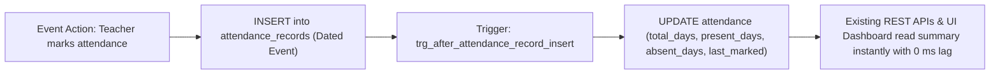
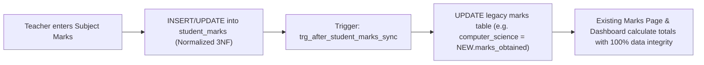

# CAMPUS HARMONY — RELATIONAL DATABASE DESIGN & NORMALIZATION ANALYSIS

**Course:** Database Management Systems (24CSE0209)  
**Evaluation:** Project-Based Evaluation (50 Marks)  
**Database Engine:** MySQL Server 8.0+ (InnoDB Storage Engine)  

---

## 1. Relational Mapping from Conceptual ER Model

The conceptual ER model maps to normalized relational tables using standard ER-to-Relational conversion rules:
1. **Strong Entities:** Converted into distinct relational tables (`departments`, `subjects`, `teachers`, `students`, `courses`).
2. **1:N Binary Relationships:** Represented by placing the Primary Key of the "1" side as a Foreign Key in the "N" side table (e.g., `teacher_id` in `students`, `subject` in `teachers`, `course_code` in `attendance_records`).
3. **1:1 Binary Relationships:** Represented by placing the primary key of the parent entity as a foreign key with a `UNIQUE` constraint in the child table (e.g., `student_id` in `attendance` and `marks`).
4. **Weak Entities / Multivalued Attributes:** Normalized into separate dependent relation tables (`attendance_records` for dated sessions, `student_marks` for subject/exam assessments) with composite candidate keys to prevent duplicates.

---

## 2. Comprehensive Data Dictionary

### Table 1: `departments` (Department Master)
Stores academic departments.
| Column | Type | Nullable | Default | Key / Constraint | Description |
| :--- | :--- | :---: | :---: | :---: | :--- |
| `id` | `INT` | No | AUTO_INCREMENT | PK | Primary Key |
| `name` | `VARCHAR(100)` | No | — | UNIQUE | Full Department Name (e.g. Computer Science) |
| `code` | `VARCHAR(10)` | No | — | UNIQUE | Abbreviation Code (e.g. CS, IT, EC, ME, CV) |

### Table 2: `subjects` (Subject Master)
Defines course subjects offered across curriculum.
| Column | Type | Nullable | Default | Key / Constraint | Description |
| :--- | :--- | :---: | :---: | :---: | :--- |
| `subject_key` | `VARCHAR(50)` | No | — | PK | Identifier (e.g. computerScience, mathematics) |
| `label` | `VARCHAR(100)` | No | — | UNIQUE | Display Title (e.g. Computer Science) |

### Table 3: `teachers` (Faculty Master)
Stores registered faculty members and their subject specialization.
| Column | Type | Nullable | Default | Key / Constraint | Description |
| :--- | :--- | :---: | :---: | :---: | :--- |
| `id` | `VARCHAR(30)` | No | — | PK | Faculty Identifier (e.g. T-1001) |
| `name` | `VARCHAR(100)` | No | — | — | Instructor Name |
| `subject` | `VARCHAR(50)` | No | — | FK -> `subjects.subject_key` | Subject Specialization |
| `workspace` | `VARCHAR(20)` | No | `'demo'` | — | `'demo'` (shared) or `'own'` (isolated) |
| `created_at` | `TIMESTAMP` | No | CURRENT_TIMESTAMP | — | Record creation timestamp |

### Table 4: `students` (Student Master)
Master entity for all enrolled students.
| Column | Type | Nullable | Default | Key / Constraint | Description |
| :--- | :--- | :---: | :---: | :---: | :--- |
| `id` | `BIGINT` | No | AUTO_INCREMENT | PK | Primary Key |
| `roll` | `VARCHAR(30)` | No | — | UNIQUE | University Roll Number (e.g. CS-2101) |
| `name` | `VARCHAR(100)` | No | — | — | Full Student Name |
| `department` | `VARCHAR(100)` | No | — | Index | Department Name |
| `semester` | `INT` | No | — | CHECK (1..8) | Academic Semester |
| `email` | `VARCHAR(120)` | No | — | UNIQUE | Institutional Email |
| `phone` | `VARCHAR(20)` | No | — | — | Contact Number |
| `status` | `VARCHAR(20)` | No | `'Active'` | CHECK (Active, Probation, Inactive) | Enrollment Status |
| `gender` | `VARCHAR(10)` | No | — | CHECK (Male, Female, Other) | Gender |
| `address` | `VARCHAR(255)` | Yes | NULL | — | Postal Address |
| `teacher_id` | `VARCHAR(30)` | Yes | NULL | FK -> `teachers.id` | Mentor/Assigned Faculty |
| `created_at` | `TIMESTAMP` | No | CURRENT_TIMESTAMP | — | Enrollment Timestamp |
| `updated_at` | `TIMESTAMP` | No | CURRENT_TIMESTAMP ON UPDATE | — | Last update timestamp |

### Table 5: `courses` (Course Catalogue)
Courses offered in current and upcoming semesters.
| Column | Type | Nullable | Default | Key / Constraint | Description |
| :--- | :--- | :---: | :---: | :---: | :--- |
| `code` | `VARCHAR(20)` | No | — | PK | Course Code (e.g. CS501) |
| `name` | `VARCHAR(150)` | No | — | — | Full Course Title |
| `faculty` | `VARCHAR(100)` | No | — | — | Instructor Name |
| `credits` | `INT` | No | — | CHECK (1..10) | Credit Weight |
| `semester` | `INT` | No | — | CHECK (1..8) | Semester Course Belongs To |
| `status` | `VARCHAR(20)` | No | `'Upcoming'` | CHECK (Upcoming, Ongoing, Completed) | Status |
| `teacher_id` | `VARCHAR(30)` | Yes | NULL | FK -> `teachers.id` | Assigned Teacher ID |
| `created_at` | `TIMESTAMP` | No | CURRENT_TIMESTAMP | — | Creation Timestamp |

### Table 6: `attendance` (Summary Cache Entity)
Aggregate attendance counters for students (supports fast dashboard KPIs and legacy JPA queries).
| Column | Type | Nullable | Default | Key / Constraint | Description |
| :--- | :--- | :---: | :---: | :---: | :--- |
| `id` | `BIGINT` | No | AUTO_INCREMENT | PK | Primary Key |
| `student_id` | `BIGINT` | No | — | UNIQUE, FK -> `students.id` | Student Reference (1:1) |
| `total_days` | `INT` | No | 0 | CHECK (>= 0) | Total Lectures Held |
| `present_days` | `INT` | No | 0 | CHECK (>= 0) | Total Lectures Attended |
| `absent_days` | `INT` | No | 0 | CHECK (>= 0) | Total Lectures Missed |
| `last_marked` | `VARCHAR(20)` | Yes | `'—'` | — | Date of last attendance mark |
| `updated_at` | `TIMESTAMP` | No | CURRENT_TIMESTAMP ON UPDATE | — | Last modification timestamp |

### Table 7: `attendance_records` (Normalized Dated Event Log)
Discrete, event-level attendance records tracking every lecture session.
| Column | Type | Nullable | Default | Key / Constraint | Description |
| :--- | :--- | :---: | :---: | :---: | :--- |
| `id` | `BIGINT` | No | AUTO_INCREMENT | PK | Primary Key |
| `student_id` | `BIGINT` | No | — | FK -> `students.id` | Student Enrolled |
| `course_code` | `VARCHAR(20)` | Yes | NULL | FK -> `courses.code` | Course Session |
| `session_date` | `DATE` | No | — | — | Date of Session |
| `status` | `ENUM('Present','Absent')`| No | — | — | Attendance State |
| `session_topic`| `VARCHAR(150)` | Yes | NULL | — | Topic Covered |
| `marked_by_teacher_id` | `VARCHAR(30)` | Yes | NULL | FK -> `teachers.id` | Teacher Who Took Session |
| `created_at` | `TIMESTAMP` | No | CURRENT_TIMESTAMP | — | Entry Timestamp |

*Constraint:* `UNIQUE KEY uk_student_session (student_id, session_date, course_code)` strictly guarantees that duplicate attendance cannot be logged for the same student, course, and date.

### Table 8: `student_marks` (Normalized Subject/Exam Evaluation)
Normalized marks table eliminating repeating subject columns.
| Column | Type | Nullable | Default | Key / Constraint | Description |
| :--- | :--- | :---: | :---: | :---: | :--- |
| `id` | `BIGINT` | No | AUTO_INCREMENT | PK | Primary Key |
| `student_id` | `BIGINT` | No | — | FK -> `students.id` | Student ID |
| `subject_key` | `VARCHAR(50)` | No | — | FK -> `subjects.subject_key` | Subject |
| `exam_type` | `VARCHAR(20)` | No | `'Endterm'` | CHECK (Internal, Midterm, Endterm, Assignment) | Evaluation Category |
| `marks_obtained` | `DECIMAL(5,2)` | No | — | CHECK (>= 0) | Score Achieved |
| `max_marks` | `DECIMAL(5,2)` | No | 100.00 | CHECK (> 0) | Maximum Score |
| `grade` | `VARCHAR(5)` | Yes | NULL | — | Computed Letter Grade (A+, A, B, C, D, F) |
| `remarks` | `VARCHAR(100)` | Yes | NULL | — | Evaluation Remarks |
| `updated_at` | `TIMESTAMP` | No | CURRENT_TIMESTAMP ON UPDATE | — | Last Update |

*Constraint:* `UNIQUE KEY uk_student_subject_exam (student_id, subject_key, exam_type)` guarantees uniqueness per student per subject per exam.  
*Constraint:* `CHECK (marks_obtained <= max_marks)` prevents impossible scores.

### Table 9: `marks` (Legacy 5-Subject Summary)
Maintained for backward compatibility with existing JPA entities.
| Column | Type | Nullable | Default | Key / Constraint | Description |
| :--- | :--- | :---: | :---: | :---: | :--- |
| `id` | `BIGINT` | No | AUTO_INCREMENT | PK | Primary Key |
| `student_id` | `BIGINT` | No | — | UNIQUE, FK -> `students.id` | Student Reference (1:1) |
| `mathematics` | `INT` | Yes | NULL | CHECK (0..100) | Mathematics Score |
| `physics` | `INT` | Yes | NULL | CHECK (0..100) | Physics Score |
| `chemistry` | `INT` | Yes | NULL | CHECK (0..100) | Chemistry Score |
| `english` | `INT` | Yes | NULL | CHECK (0..100) | English Score |
| `computer_science` | `INT` | Yes | NULL | CHECK (0..100) | Computer Science Score |
| `updated_at` | `TIMESTAMP` | No | CURRENT_TIMESTAMP ON UPDATE | — | Last Update Timestamp |

### Table 10: `activities` (Audit & Feed Log)
Audit log tracking announcements, marks updates, and enrollments.
| Column | Type | Nullable | Default | Key / Constraint | Description |
| :--- | :--- | :---: | :---: | :---: | :--- |
| `id` | `BIGINT` | No | AUTO_INCREMENT | PK | Primary Key |
| `text` | `VARCHAR(255)` | No | — | — | Activity Description |
| `type` | `VARCHAR(50)` | No | `'notice'` | — | Event Type (`notice`, `attendance`, `enroll`, `grade`) |
| `teacher_id` | `VARCHAR(30)` | Yes | NULL | FK -> `teachers.id` | Authoring Teacher |
| `created_at` | `TIMESTAMP` | No | CURRENT_TIMESTAMP | — | Timestamp of Event |

### Table 11: `defaulter_audit_log` (Procedural Cursor Output Log)
Populated dynamically by stored procedure `sp_generate_attendance_defaulter_report`.
| Column | Type | Nullable | Default | Key / Constraint | Description |
| :--- | :--- | :---: | :---: | :---: | :--- |
| `id` | `BIGINT` | No | AUTO_INCREMENT | PK | Primary Key |
| `student_id` | `BIGINT` | No | — | — | Student Reference |
| `roll` | `VARCHAR(30)` | No | — | — | Roll Number |
| `student_name` | `VARCHAR(100)` | No | — | — | Student Name |
| `department` | `VARCHAR(100)` | No | — | — | Department |
| `attendance_percentage` | `DECIMAL(5,2)` | No | — | — | Calculated Attendance % |
| `classes_needed`| `INT` | No | — | — | Lectures needed to reach 75% |
| `reported_at` | `TIMESTAMP` | No | CURRENT_TIMESTAMP | — | Report Run Timestamp |

---

## 3. Functional Dependencies and Normalization Analysis

### A. Functional Dependencies ($X \to Y$)

1. **Relation `students`:**
   - $\text{id} \to \{\text{roll}, \text{name}, \text{department}, \text{semester}, \text{email}, \text{phone}, \text{status}, \text{gender}, \text{address}, \text{teacher\_id}\}$
   - $\text{roll} \to \{\text{id}, \text{name}, \text{department}, \text{semester}, \text{email}, \text{phone}, \text{status}, \text{gender}, \text{address}, \text{teacher\_id}\}$
   - $\text{email} \to \{\text{id}, \text{roll}, \text{name}, \text{department}, \text{semester}, \text{phone}, \text{status}, \text{gender}, \text{address}, \text{teacher\_id}\}$
   - *Candidate Keys:* $\{\text{id}\}$, $\{\text{roll}\}$, $\{\text{email}\}$.

2. **Relation `departments`:**
   - $\text{id} \to \{\text{name}, \text{code}\}$
   - $\text{code} \to \{\text{id}, \text{name}\}$
   - $\text{name} \to \{\text{id}, \text{code}\}$
   - *Candidate Keys:* $\{\text{id}\}$, $\{\text{code}\}$, $\{\text{name}\}$.

3. **Relation `courses`:**
   - $\text{code} \to \{\text{name}, \text{faculty}, \text{credits}, \text{semester}, \text{status}, \text{teacher\_id}\}$
   - *Candidate Key:* $\{\text{code}\}$.

4. **Relation `attendance_records`:**
   - $\{\text{student\_id}, \text{session\_date}, \text{course\_code}\} \to \{\text{id}, \text{status}, \text{session\_topic}, \text{marked\_by\_teacher\_id}, \text{created\_at}\}$
   - $\text{id} \to \{\text{student\_id}, \text{course\_code}, \text{session\_date}, \text{status}, \text{session\_topic}, \text{marked\_by\_teacher\_id}, \text{created\_at}\}$
   - *Candidate Keys:* $\{\text{id}\}$, $\{\text{student\_id}, \text{session\_date}, \text{course\_code}\}$.

5. **Relation `student_marks`:**
   - $\{\text{student\_id}, \text{subject\_key}, \text{exam\_type}\} \to \{\text{id}, \text{marks\_obtained}, \text{max\_marks}, \text{grade}, \text{remarks}, \text{updated\_at}\}$
   - $\text{id} \to \{\text{student\_id}, \text{subject\_key}, \text{exam\_type}, \text{marks\_obtained}, \text{max\_marks}, \text{grade}, \text{remarks}, \text{updated\_at}\}$
   - *Candidate Keys:* $\{\text{id}\}$, $\{\text{student\_id}, \text{subject\_key}, \text{exam\_type}\}$.

---

### B. Normalization Step-by-Step Progression

#### Step 1: First Normal Form (1NF)
- **1NF Definition:** A relation is in 1NF if and only if all underlying domains contain only atomic (indivisible) values, and there are no repeating groups or multivalued columns.
- **Flaw in baseline schema:** The legacy `marks` table stored repeating columns for subjects: `mathematics`, `physics`, `chemistry`, `english`, `computer_science`. Adding a 6th subject would require DDL schema alteration (`ALTER TABLE`), violating relational principles.
- **Resolution to 1NF:** We introduce `student_marks`, where each tuple represents an atomic evaluation of one student, in one subject, for one exam type (`marks_obtained`, `max_marks`). Every field contains a single atomic scalar value.

#### Step 2: Second Normal Form (2NF)
- **2NF Definition:** A relation is in 2NF if it is in 1NF and no non-prime attribute is partially dependent on any candidate key (i.e., no partial dependency $X \to Y$ where $X \subset \text{Candidate Key}$).
- **Analysis:**
  - For `student_marks`, candidate key is $\{\text{student\_id}, \text{subject\_key}, \text{exam\_type}\}$.
  - Non-prime attributes: `marks_obtained`, `max_marks`, `grade`, `remarks`.
  - None of these attributes depend on only `student_id` or only `subject_key`. You cannot determine `marks_obtained` without knowing which student, which subject, AND which exam.
  - Thus, all non-prime attributes are fully functionally dependent on the entire composite key.
- **Conclusion:** `student_marks` and `attendance_records` strictly satisfy 2NF.

#### Step 3: Third Normal Form (3NF)
- **3NF Definition:** A relation is in 3NF if it is in 2NF and there is no transitive dependency of non-prime attributes on any candidate key (i.e., for every non-trivial $X \to Y$, either $X$ is a superkey or $Y$ is a prime attribute).
- **Analysis:**
  - In `students`, all attributes (`name`, `semester`, `phone`, `email`) depend directly on `id`/`roll`.
  - In `student_marks`, `grade` is functionally derived from `marks_obtained` and `max_marks`. Storing grade without constraints could introduce an update anomaly (e.g. 95% marked as 'F'). We resolve this by computing `grade` dynamically via deterministic stored function `fn_calculate_grade()` enforced through a `BEFORE INSERT/UPDATE` trigger.
- **Conclusion:** The database satisfies 3NF.

#### Step 4: Boyce-Codd Normal Form (BCNF)
- **BCNF Definition:** A relation is in BCNF if for every non-trivial functional dependency $X \to Y$, $X$ is a superkey.
- **Analysis:**
  - In `students`:
    - $\text{id} \to Y$ ($X=\text{id}$ is a candidate key / superkey).
    - $\text{roll} \to Y$ ($X=\text{roll}$ is a candidate key / superkey).
    - $\text{email} \to Y$ ($X=\text{email}$ is a candidate key / superkey).
  - In `departments`:
    - $\text{id} \to Y$, $\text{code} \to Y$, $\text{name} \to Y$. Every determinant is a candidate key.
  - In `student_marks`:
    - $\{\text{student\_id}, \text{subject\_key}, \text{exam\_type}\}$ and $\{\text{id}\}$ are the only determinants, and both are superkeys.
- **Conclusion:** The normalized schema satisfies BCNF.

---

## 4. Dual-Model Synchronization (Zero-Regression Strategy)

To ensure earlier evaluated work, existing REST controllers, and frontend pages continue functioning without modification, we implement automatic synchronization between normalized event logs and summary caches:

Similarly, for marks:

---

## 5. Indexing Architecture & Query Performance

| Table | Index Name | Indexed Columns | Index Type | Optimization Target / Rationale |
| :--- | :--- | :--- | :---: | :--- |
| `students` | `idx_students_dept` | `(department)` | B-Tree | Optimizes department filter dropdown on Students page. |
| `students` | `idx_students_sem` | `(semester)` | B-Tree | Speeds up semester filtering and batch grade calculations. |
| `students` | `idx_students_status` | `(status)` | B-Tree | Speeds up active vs probation student queries. |
| `courses` | `idx_courses_sem` | `(semester)` | B-Tree | Optimizes course catalogue browsing per semester. |
| `attendance_records` | `idx_att_rec_student_date` | `(student_id, session_date)` | B-Tree | Optimizes historical attendance timeline retrieval for student profiles. |
| `student_marks` | `idx_sm_student` | `(student_id)` | B-Tree | Accelerates grade sheet and report card generation. |
| `activities` | `idx_activities_time` | `(created_at DESC)` | B-Tree | Accelerates recent activity feed query on dashboard (`ORDER BY created_at DESC LIMIT 10`). |
