# CAMPUS HARMONY — ENTITY-RELATIONSHIP (ER) MODEL & DIAGRAM (FINAL PHASE 2)

**Course Context:** Database Management Systems (24CSE0209)  
**Project Identity:** Campus Harmony (College ERP / Student Management System)  
**Academic Session:** July–December 2026, Semester III, Batch 2025  
**Document Revision:** Version 3.0 (Final Comprehensive Revision)  

---

## 1. Case Study & Business Domain

Campus Harmony is a centralized Student Information and Enterprise Resource Planning (ERP) system designed for educational institutions. The system models academic administration across multiple departments, subjects, faculty members, enrolled students, academic periods, course catalogues, formal course enrollments, lecture attendance sessions, event-level attendance tracking, and semester examination performance.

### A. Academic Hierarchy & Curricular Structure
1. **Departments & Affiliation:** The institute comprises multiple academic departments (e.g., Computer Science, Information Technology, Electronics, Mechanical, Civil). Each department is uniquely identified by an integer `id`, department `code` (e.g., `CS`), and full `name`. Every faculty member and enrolled student is affiliated with exactly one academic department (`department_id`).
2. **Subject vs. Course (Structural Distinction):**
   - **Subject (Curricular Domain / Academic Discipline):** A foundational discipline or broad knowledge area evaluated in university degree curricula (e.g., `computerScience`, `mathematics`, `physics`, `chemistry`, `english`). Each faculty member specializes in one subject, and student cumulative evaluations are categorized under subjects.
   - **Course (Specific Instructional Module / Class Offering):** A concrete operational lecture course offered in a particular semester with defined credit hours, syllabus, and assigned teacher (e.g., `CS501` "Data Structures & Algorithms", `CS502` "Operating Systems", `IT301` "Database Management Systems", `EC701` "VLSI Design"). Every course belongs to one parent Subject domain and is offered by one Department.
3. **Academic Periods (Terms):**
   - Formal university academic terms (e.g. Autumn 2026, Spring 2027) are represented in `ACADEMIC_PERIODS` (`id`, `code`, `name`, `academic_year`, `semester_term`, `is_current`).
   - Both course enrollments and student marks link to `academic_period_id`. This permits repeated examinations across different terms (e.g., backlog, improvement, or recurring subjects) while strictly preventing duplicates within the same term via candidate key `(student_id, subject_key, exam_type, academic_period_id)`.
4. **Course Enrollments (Associative Entity):**
   - Student course registration is represented independently of attendance via `COURSE_ENROLLMENTS`. A student explicitly enrolls in specific courses each term (`Enrolled`, `Dropped`, `Completed`).
5. **Attendance Sessions & Event Records (Enrollment-Gated Attendance):**
   - **Attendance Sessions (`ATTENDANCE_SESSIONS`):** Represents an actual lecture or lab event conducted by an instructor (`course_code`, `session_date`, `session_slot`, `session_type`, `teacher_id`). The unique constraint `uk_course_session_slot (course_code, session_date, session_slot)` supports multiple sessions on the same date (e.g., Slot 1 Morning Lecture and Slot 2 Afternoon Lab) while preventing duplicate session creation.
   - **Attendance Records (`ATTENDANCE_RECORDS`):** Individual student attendance for a session. It references `session_id`, `student_id`, and `enrollment_id`. This foreign key linkage guarantees that attendance can **only** be marked for a student who is actively enrolled in that course! Uniqueness is enforced via `uk_session_student (session_id, student_id)`.
   - **Attendance Summary (`ATTENDANCE`):** A physical summary table containing cumulative counters (`total_days`, `present_days`, `absent_days`, `last_marked`) updated automatically via triggers for $O(1)$ dashboard reads. Structurally, it is an optional $0..1$ relationship until initialized.
6. **Academic Performance (Marks):**
   - **Normalized Evaluations (`STUDENT_MARKS`):** Examination scores are tracked per student, per subject, per exam type, and per academic period. Supported exam types are strictly standardized as `'Internal'`, `'Midterm'`, and `'Endterm'`. Bounds ($0 \le \text{marks\_obtained} \le \text{max\_marks}$) and grade calculation (`A+`, `A`, `B`, `C`, `D`, `F`) are enforced via database triggers and functions.
   - **Legacy 5-Subject Summary (`MARKS`):** Maintained as an explicit **Physical Summary Cache Table** for backward compatibility with existing Spring Boot JPA repositories and 5-subject UI screens, synchronized with `STUDENT_MARKS` via database triggers.
7. **Administrative Notices & Activities (`ACTIVITIES`):** Administrative notices and activity logs with optional author reference (`teacher_id`, nullable for system-wide notices).
8. **Immutable Defaulter Audit Log (`DEFAULTER_AUDIT_LOG`):** An administrative audit table populated by the cursor procedure `sp_generate_attendance_defaulter_report`. It stores historical point-in-time snapshots of attendance defaulters. Its foreign key `student_id` is declared `ON DELETE SET NULL`, ensuring that deleting a student from master tables **cannot destroy historical audit compliance logs**!

---

## 2. Complete Mermaid Crow's Foot Entity-Relationship Diagram

```mermaid
erDiagram
    DEPARTMENTS ||--|{ TEACHERS : "employs"
    DEPARTMENTS ||--|{ STUDENTS : "enrolls"
    DEPARTMENTS ||--|{ COURSES : "offers"

    SUBJECTS ||--|{ TEACHERS : "specializes in"
    SUBJECTS ||--|{ COURSES : "categorizes"
    SUBJECTS ||--|{ STUDENT_MARKS : "evaluated under"

    ACADEMIC_PERIODS ||--o{ COURSE_ENROLLMENTS : "structures"
    ACADEMIC_PERIODS ||--o{ STUDENT_MARKS : "records for"

    TEACHERS |o--o{ STUDENTS : "mentors (optional)"
    TEACHERS |o--o{ COURSES : "instructs (optional)"
    TEACHERS |o--o{ ACTIVITIES : "authors (optional)"
    TEACHERS |o--o{ ATTENDANCE_SESSIONS : "conducts (optional)"

    STUDENTS ||--|{ COURSE_ENROLLMENTS : "registers"
    COURSES ||--|{ COURSE_ENROLLMENTS : "has roster"

    COURSES ||--o{ ATTENDANCE_SESSIONS : "schedules"
    ATTENDANCE_SESSIONS ||--|{ ATTENDANCE_RECORDS : "contains marks"

    COURSE_ENROLLMENTS ||--o{ ATTENDANCE_RECORDS : "validates attendance"
    STUDENTS ||--o{ ATTENDANCE_RECORDS : "attends"

    STUDENTS |o--o| ATTENDANCE : "has summary cache (0..1 until init)"
    STUDENTS |o--o| MARKS : "has legacy summary cache (0..1 until init)"

    STUDENTS ||--|{ STUDENT_MARKS : "earns"
    STUDENTS |o--o{ DEFAULTER_AUDIT_LOG : "referenced in (ON DELETE SET NULL)"

    DEPARTMENTS {
        int id PK "Department ID"
        string name UK "Unique department name"
        string code UK "Department abbreviation, e.g. CS"
    }

    SUBJECTS {
        string subject_key PK "e.g. computerScience, mathematics"
        string label UK "Display title, e.g. Computer Science"
    }

    ACADEMIC_PERIODS {
        int id PK "Period ID"
        string code UK "Term code, e.g. 2026-ODD"
        string name "Term name, e.g. Autumn 2026"
        string academic_year "e.g. 2026-2027"
        string semester_term "Odd or Even"
        boolean is_current "Active flag"
    }

    TEACHERS {
        string id PK "e.g. T-1001"
        string name "Faculty name"
        int department_id FK "References departments.id"
        string subject FK "References subjects.subject_key"
        string workspace "demo or own"
        timestamp created_at
    }

    STUDENTS {
        bigint id PK "Student ID"
        string roll UK "University roll number, e.g. CS-2101"
        string name "Student full name"
        int department_id FK "References departments.id (Authoritative)"
        string department "Synchronized legacy name string"
        int semester "Semester 1 to 8"
        string email UK "Unique institutional email"
        string phone "Contact phone number"
        string status "Active, Probation, Inactive"
        string gender "Male, Female, Other"
        string address "Residential address"
        string teacher_id FK "References teachers.id (nullable)"
        timestamp created_at
        timestamp updated_at
    }

    COURSES {
        string code PK "Course code, e.g. CS501"
        string name "Course title"
        int department_id FK "References departments.id"
        string subject_key FK "References subjects.subject_key"
        int credits "Credits 1 to 10"
        int semester "Semester 1 to 8"
        string status "Upcoming, Ongoing, Completed"
        string teacher_id FK "References teachers.id (nullable)"
        string faculty "Derived/legacy instructor string"
        timestamp created_at
    }

    COURSE_ENROLLMENTS {
        bigint id PK "Enrollment ID"
        bigint student_id FK "References students.id"
        string course_code FK "References courses.code"
        int academic_period_id FK "References academic_periods.id"
        date enrollment_date "Date student registered"
        string status "Enrolled, Dropped, Completed"
        string grade "Final course grade (nullable)"
        timestamp created_at
    }

    ATTENDANCE_SESSIONS {
        bigint id PK "Session ID"
        string course_code FK "References courses.code"
        string teacher_id FK "References teachers.id (nullable)"
        date session_date "Date of session"
        int session_slot "Slot 1..10 (permits multi-session/day)"
        string session_type "Lecture, Lab, Tutorial"
        string session_topic "Topic covered"
        timestamp created_at
    }

    ATTENDANCE_RECORDS {
        bigint id PK "Record ID"
        bigint session_id FK "References attendance_sessions.id"
        bigint enrollment_id FK "References course_enrollments.id"
        bigint student_id FK "References students.id"
        string status "Present or Absent"
        string remarks "Notes (nullable)"
        timestamp created_at
    }

    ATTENDANCE {
        bigint id PK "Summary Cache ID"
        bigint student_id UK, FK "References students.id (1:1 candidate)"
        int total_days "Total lecture sessions"
        int present_days "Attended lecture sessions"
        int absent_days "Missed lecture sessions"
        string last_marked "Date string YYYY-MM-DD"
        timestamp updated_at
    }

    STUDENT_MARKS {
        bigint id PK "Marks Entry ID"
        bigint student_id FK "References students.id"
        string subject_key FK "References subjects.subject_key"
        int academic_period_id FK "References academic_periods.id"
        int semester "Semester 1 to 8"
        string exam_type "Internal, Midterm, Endterm"
        decimal marks_obtained "Score obtained"
        decimal max_marks "Maximum possible score"
        string grade "Computed grade: A+, A, B, C, D, F"
        string remarks "Evaluator notes (nullable)"
        timestamp updated_at
    }

    MARKS {
        bigint id PK "Physical Legacy Cache ID"
        bigint student_id UK, FK "References students.id (1:1 candidate)"
        int mathematics "Maths score (0-100)"
        int physics "Physics score (0-100)"
        int chemistry "Chemistry score (0-100)"
        int english "English score (0-100)"
        int computer_science "CS score (0-100)"
        timestamp updated_at
    }

    ACTIVITIES {
        bigint id PK "Activity ID"
        string text "Notice or activity description"
        string type "notice, attendance, grade, enroll, course"
        string teacher_id FK "References teachers.id (nullable)"
        timestamp created_at
    }

    DEFAULTER_AUDIT_LOG {
        bigint id PK "Audit Entry ID"
        bigint student_id FK "References students.id (ON DELETE SET NULL)"
        string roll "Immutable snapshot roll number"
        string student_name "Immutable snapshot student name"
        string department "Immutable snapshot department"
        decimal attendance_percentage "Immutable snapshot percentage"
        int classes_needed "Shortfall classes to reach 75%"
        timestamp reported_at "Audit generation timestamp"
    }
```

---

## 3. Entity-Relationship Cardinality & Participation Matrix

| Relationship | Entity 1 | Multiplicity (E1) | Participation (E1) | Entity 2 | Multiplicity (E2) | Participation (E2) | Structural Meaning |
| :--- | :--- | :---: | :---: | :--- | :---: | :---: | :--- |
| **Department Employs Teachers** | `DEPARTMENTS` | $1$ | Mandatory | `TEACHERS` | $1..N$ | Optional (dept exists before hiring) | A department employs 0 to many teachers; each teacher is appointed to exactly one department (`department_id NOT NULL`). |
| **Department Enrolls Students** | `DEPARTMENTS` | $1$ | Mandatory | `STUDENTS` | $0..N$ | Mandatory for student | A department enrolls 0 to many students; each student must belong to exactly one department (`department_id NOT NULL`). |
| **Department Offers Courses** | `DEPARTMENTS` | $1$ | Mandatory | `COURSES` | $0..N$ | Mandatory for course | A department offers 0 to many courses; each course is owned by one department (`department_id NOT NULL`). |
| **Subject Categorizes Courses** | `SUBJECTS` | $1$ | Mandatory | `COURSES` | $1..N$ | Mandatory for course | A subject classifies multiple course offerings; each course maps to exactly one subject discipline (`subject_key NOT NULL`). |
| **Subject Specialization of Faculty** | `SUBJECTS` | $1$ | Mandatory | `TEACHERS` | $1..N$ | Mandatory for teacher | A subject is taught by multiple teachers; each teacher specializes in exactly one subject. |
| **Subject Evaluation** | `SUBJECTS` | $1$ | Mandatory | `STUDENT_MARKS`| $1..N$ | Mandatory for mark entry | Each evaluation row is scored under one subject; a subject has many score records. |
| **Academic Period Structures Enrollments**| `ACADEMIC_PERIODS` | $1$ | Mandatory | `COURSE_ENROLLMENTS`| $0..N$ | Mandatory for enrollment | An academic period structures registrations; each enrollment references one term. |
| **Academic Period Evaluates Marks** | `ACADEMIC_PERIODS` | $1$ | Mandatory | `STUDENT_MARKS`| $0..N$ | Mandatory for mark entry | An academic period frames examinations; each mark entry references one term. |
| **Faculty Mentorship** | `TEACHERS` | $0..1$ | Optional | `STUDENTS` | $0..N$ | Optional for student | A teacher mentors 0 to many students; a student has at most one faculty mentor (`teacher_id NULL` permitted). |
| **Course Instruction** | `TEACHERS` | $0..1$ | Optional | `COURSES` | $0..N$ | Optional for course | A teacher instructs 0 to many courses; a course may have an assigned teacher or be unassigned (`teacher_id NULL` permitted). |
| **Activity Authorship** | `TEACHERS` | $0..1$ | Optional | `ACTIVITIES` | $0..N$ | Optional for activity | A teacher authors 0 to many activities; an activity may be system-generated without a faculty author (`teacher_id NULL` permitted). |
| **Attendance Session Conduction** | `TEACHERS` | $0..1$ | Optional | `ATTENDANCE_SESSIONS`| $0..N$ | Optional for session | A teacher conducts 0 to many lecture sessions; a session has an optional faculty invigilator reference. |
| **Student Course Registration** | `STUDENTS` | $1$ | Mandatory | `COURSE_ENROLLMENTS`| $0..N$ | Mandatory for enrollment | A student registers for 0 to many courses; an enrollment record references exactly one student. |
| **Course Roster** | `COURSES` | $1$ | Mandatory | `COURSE_ENROLLMENTS`| $0..N$ | Mandatory for enrollment | A course enrolls 0 to many students; each enrollment belongs to exactly one course. |
| **Course Session Scheduling** | `COURSES` | $1$ | Mandatory | `ATTENDANCE_SESSIONS`| $0..N$ | Mandatory for session | A course schedules 0 to many attendance sessions; each session belongs to one course. |
| **Session Attendance Marks** | `ATTENDANCE_SESSIONS`| $1$ | Mandatory | `ATTENDANCE_RECORDS` | $1..N$ | Mandatory for record | A session contains student attendance marks; each attendance record belongs to one session. |
| **Enrollment Validation of Attendance** | `COURSE_ENROLLMENTS` | $1$ | Mandatory | `ATTENDANCE_RECORDS` | $0..N$ | Mandatory for record | An enrollment validates attendance; a student can only have attendance recorded if enrolled in that course! |
| **Student Attendance Sessions** | `STUDENTS` | $1$ | Mandatory | `ATTENDANCE_RECORDS`| $0..N$ | Mandatory for record | A student attends 0 to many lecture sessions; each attendance record references one student. |
| **Student Attendance Summary** | `STUDENTS` | $1$ | Mandatory | `ATTENDANCE` | $0..1$ | Mandatory for summary | A student has at most one summary cache (structural $0..1$ until initialized); summary requires student (`student_id NOT NULL UNIQUE`). |
| **Student Legacy Marks Cache** | `STUDENTS` | $1$ | Mandatory | `MARKS` | $0..1$ | Mandatory for summary | A student has at most one physical summary cache (structural $0..1$ until initialized); summary requires student (`student_id NOT NULL UNIQUE`). |
| **Student Marks Evaluations** | `STUDENTS` | $1$ | Mandatory | `STUDENT_MARKS` | $1..N$ | Mandatory for mark entry | A student receives 1 to many subject-exam evaluations; each score entry belongs to one student. |
| **Defaulter Audit Tracking** | `STUDENTS` | $0..1$ | Optional | `DEFAULTER_AUDIT_LOG`| $0..N$ | Mandatory for audit row | Deleting a student sets `student_id = NULL`; the audit snapshot survives permanently (`ON DELETE SET NULL`). |
