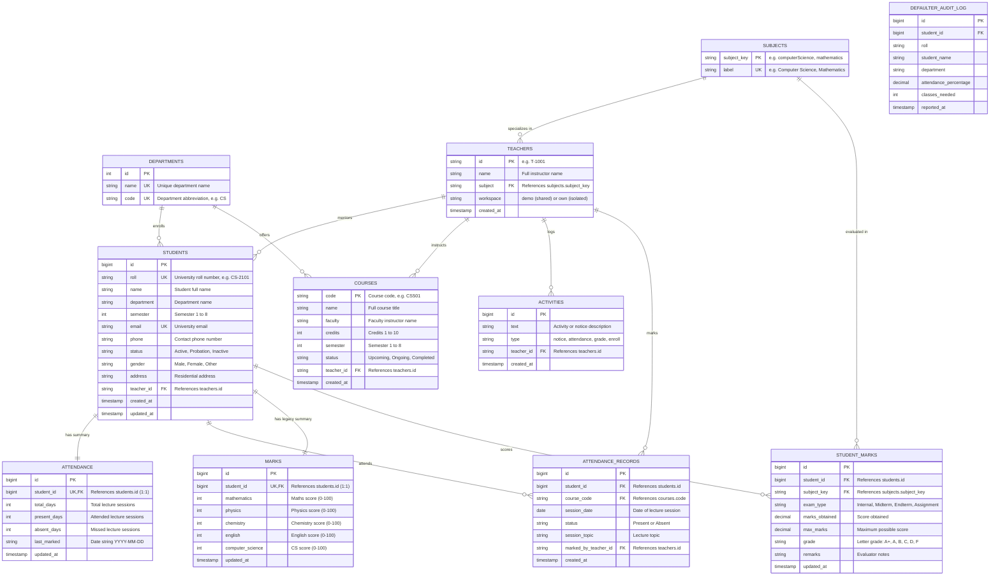

# CAMPUS HARMONY — ENTITY-RELATIONSHIP (ER) MODEL & DIAGRAM

**Course Context:** Database Management Systems (24CSE0209)  
**Project:** Campus Harmony (College ERP / Student Management System)  
**Session:** July–December 2026, Semester III, Batch 2025  

---

## 1. Case Study & Business Domain

Campus Harmony is a centralized Student Information and Enterprise Resource Planning (ERP) system designed for educational institutions. The system models academic administration across multiple departments, subjects, faculty members, enrolled students, course catalogues, continuous attendance registers, and academic examination performance.

### Key Business Rules & Requirements:
1. **Departments & Specialization:** The institute comprises multiple academic departments (e.g., Computer Science, Information Technology, Electronics, Mechanical, Civil). Each department is identified by a unique department code and name.
2. **Faculty Members (Teachers):** Each teacher belongs to an academic department and specializes in a specific subject (e.g., Computer Science, Mathematics, Physics, Chemistry, English). Teachers may operate in a shared college workspace or an isolated personal class workspace.
3. **Student Enrollment:** Students enroll with a unique University Roll Number (e.g., `CS-2101`), full name, academic department, current semester (1–8), university email, contact phone number, enrollment status (`Active`, `Probation`, `Inactive`), and gender.
4. **Courses:** Each course has a course code (e.g., `CS501`), course name, credits (1–10), semester, and designated instructor.
5. **Attendance Events & Summaries:**
   - Every class session produces a dated attendance record (`attendance_records`) indicating whether an enrolled student was `Present` or `Absent`. Duplicate attendance for the same student on the same date for the same course is strictly prevented by database constraints.
   - For fast dashboard querying and backward compatibility, summary counters (`total_days`, `present_days`, `absent_days`, `last_marked`) are maintained in the `attendance` entity and synchronized automatically via database triggers.
6. **Academic Performance (Marks):**
   - Examination evaluations are tracked per student, per subject, and per exam type (`Internal`, `Midterm`, `Endterm`) in `student_marks`.
   - Bounds checking ($0 \le \text{marks\_obtained} \le \text{max\_marks}$) and grade calculation (`A+`, `A`, `B`, `C`, `D`, `F`) are enforced via database triggers and functions.
   - For historical reporting and existing UI compatibility, five standard subject scores are mirrored in `marks`.
7. **Audit & Activity Log:** Real-time administrative notices, enrollment alerts, and marks submissions are logged with timestamp and author reference in `activities`.

---

## 2. Entity-Relationship Diagram (Crow's Foot Notation)

---

## 3. Entities, Attributes and Cardinalities

| Entity 1 | Relationship | Entity 2 | Cardinality | Explanation |
| :--- | :---: | :--- | :---: | :--- |
| **Departments** | Offers | **Students** | $1 : N$ | One department enrolls many students; each student belongs to exactly one department. |
| **Subjects** | Specialization | **Teachers** | $1 : N$ | One subject is taught by multiple teachers; each teacher specializes in one subject. |
| **Teachers** | Instructs | **Courses** | $1 : N$ | A teacher may teach zero, one, or multiple courses; a course is assigned to one teacher. |
| **Teachers** | Mentors | **Students** | $1 : N$ | A teacher can mentor a cohort of students; a student has at most one faculty mentor. |
| **Students** | Summary | **Attendance** | $1 : 1$ | Each student possesses exactly one aggregate attendance summary cache. |
| **Students** | Sessions | **Attendance Records** | $1 : N$ | A student has multiple dated session records; each session belongs to one student. |
| **Students** | Scores | **Student Marks** | $1 : N$ | A student receives multiple subject/exam scores; each score row belongs to one student. |
| **Subjects** | Evaluated In | **Student Marks** | $1 : N$ | A subject has multiple evaluation records across students; each evaluation specifies one subject. |
| **Teachers** | Author | **Activities** | $1 : N$ | A teacher posts multiple activity/notice events; an activity has an optional author. |

---

## 4. Key Constraints and Integrity Rules

1. **Entity Integrity:** Every relation has a non-null Primary Key (`id`, `roll`, `code`, or `subject_key`).
2. **Referential Integrity:**
   - Foreign keys enforce parent-child relationships with explicit `ON DELETE CASCADE` (for dependent child rows such as `attendance` and `student_marks`) or `ON DELETE SET NULL` (for optional associations such as `courses.teacher_id`).
3. **Domain & Check Constraints:**
   - Semester: `CHECK (semester BETWEEN 1 AND 8)`
   - Course Credits: `CHECK (credits BETWEEN 1 AND 10)`
   - Student Status: `CHECK (status IN ('Active', 'Probation', 'Inactive'))`
   - Attendance Non-Negative: `CHECK (total_days >= 0 AND present_days >= 0 AND absent_days >= 0)`
   - Marks Bounds: `CHECK (marks_obtained >= 0 AND marks_obtained <= max_marks)`
4. **Unique Constraints:**
   - `students.roll` is UNIQUE.
   - `students.email` is UNIQUE.
   - `departments.code` and `departments.name` are UNIQUE.
   - Composite Unique: `uk_student_session (student_id, session_date, course_code)` guarantees idempotent attendance logging without duplicate session inflation.
   - Composite Unique: `uk_student_subject_exam (student_id, subject_key, exam_type)` prevents duplicate exam entries for the same student, subject, and evaluation period.
