# CAMPUS HARMONY — ENTITY-RELATIONSHIP (ER) MODEL & DIAGRAM (REVISED PHASE 2)

**Course Context:** Database Management Systems (24CSE0209)  
**Project Identity:** Campus Harmony (College ERP / Student Management System)  
**Academic Session:** July–December 2026, Semester III, Batch 2025  
**Document Revision:** Version 2.0 (Post-Review Academic Alignment)  

---

## 1. Case Study & Business Domain

Campus Harmony is a centralized Student Information and Enterprise Resource Planning (ERP) system designed for educational institutions. The system models academic administration across multiple departments, subjects, faculty members, enrolled students, course catalogues, formal course enrollments, continuous attendance registers, and academic examination performance.

### A. Academic Hierarchy & Curricular Structure
1. **Departments & Affiliation:** The institute comprises multiple academic departments (e.g., Computer Science, Information Technology, Electronics, Mechanical, Civil). Each department is uniquely identified by an integer `id`, department `code` (e.g., `CS`), and full `name`. Every faculty member and enrolled student is affiliated with exactly one academic department.
2. **Subjects vs. Courses (Crucial Distinction):**
   - **Subject (Curricular Domain / Academic Discipline):** A foundational discipline or evaluation subject in the university curriculum (e.g., `computerScience`, `mathematics`, `physics`, `chemistry`, `english`). Each faculty member specializes in one subject, and students receive cumulative assessments under subject areas.
   - **Course (Specific Instructional Module / Class Offering):** A concrete operational lecture course offered in a particular semester with defined credit hours, syllabus, and assigned teacher (e.g., `CS501` "Data Structures & Algorithms", `CS502` "Operating Systems", `IT301` "Database Management Systems", `EC701` "VLSI Design"). Every course belongs to one parent Subject domain and is offered by one Department.
3. **Faculty Members (Teachers):** Each teacher belongs to an academic department (`department_id`) and specializes in a specific subject (`subject`). Teachers may operate in a shared college workspace (`'demo'`) or an isolated personal class workspace (`'own'`). Teachers instruct zero, one, or multiple courses, and may optionally mentor students.
4. **Student Enrollment & Course Registrations:**
   - **Student Master:** Students enroll with a unique University Roll Number (e.g., `CS-2101`), full name, academic department foreign key (`department_id`), current semester (1–8), institutional email, contact phone number, enrollment status (`Active`, `Probation`, `Inactive`), and gender. A student has an optional faculty mentor (`teacher_id`).
   - **Course Enrollments (Associative Entity):** Course registration is explicitly represented independently of attendance through `COURSE_ENROLLMENTS`. A student explicitly registers for specific courses each semester with an enrollment date and status (`Enrolled`, `Dropped`, `Completed`).
5. **Attendance Events & Summaries:**
   - **Dated Lecture Sessions (`ATTENDANCE_RECORDS`):** Every conducted lecture session produces a dated attendance record indicating whether an enrolled student was `Present` or `Absent`. Duplicate attendance for the same student on the same date for the same course is strictly prevented by unique constraint `uk_student_session (student_id, session_date, course_code)`.
   - **Attendance Summary (`ATTENDANCE`):** A summary row containing cumulative counters (`total_days`, `present_days`, `absent_days`, `last_marked`). It is populated upon student enrollment and kept synchronized with event logs via triggers. Structurally, it is an optional $0..1$ relationship until initialized.
6. **Academic Performance (Marks):**
   - **Normalized Evaluations (`STUDENT_MARKS`):** Examination scores are tracked per student, per subject, and per exam type. Supported exam types are strictly standardized as `'Internal'`, `'Midterm'`, and `'Endterm'`. Bounds ($0 \le \text{marks\_obtained} \le \text{max\_marks}$) and grade calculation (`A+`, `A`, `B`, `C`, `D`, `F`) are enforced via database triggers and deterministic functions.
   - **Legacy 5-Subject Summary (`MARKS`):** Maintained solely as a cached compatibility table for the existing 5-subject UI screen, synchronized with `STUDENT_MARKS` via triggers.
7. **Administrative Notices & Activities (`ACTIVITIES`):** Real-time administrative notices, enrollment alerts, and marks submissions are logged with timestamp and an optional author reference (`teacher_id`, nullable for system-wide notices).
8. **Audit Log (`DEFAULTER_AUDIT_LOG`):** An administrative audit table populated by the cursor procedure `sp_generate_attendance_defaulter_report`. It stores historical point-in-time snapshots of attendance defaulters ($< 75\%$) and consecutive lectures required for eligibility.

---

## 2. Corrected Crow's Foot Entity-Relationship Diagram

```mermaid
erDiagram
    DEPARTMENTS ||--|{ TEACHERS : "employs"
    DEPARTMENTS ||--|{ STUDENTS : "enrolls"
    DEPARTMENTS ||--|{ COURSES : "offers"

    SUBJECTS ||--|{ TEACHERS : "specializes in"
    SUBJECTS ||--|{ COURSES : "categorizes"
    SUBJECTS ||--|{ STUDENT_MARKS : "evaluated under"

    TEACHERS |o--o{ STUDENTS : "mentors (optional)"
    TEACHERS |o--o{ COURSES : "instructs (optional)"
    TEACHERS |o--o{ ACTIVITIES : "authors (optional)"
    TEACHERS |o--o{ ATTENDANCE_RECORDS : "marks (optional)"

    STUDENTS ||--|{ COURSE_ENROLLMENTS : "registers"
    COURSES ||--|{ COURSE_ENROLLMENTS : "has roster"

    STUDENTS |o--o| ATTENDANCE : "has summary (0..1 until init)"
    STUDENTS ||--o{ ATTENDANCE_RECORDS : "attends"

    STUDENTS |o--o| MARKS : "has legacy summary (0..1 until init)"
    STUDENTS ||--|{ STUDENT_MARKS : "scores"

    STUDENTS ||--o{ DEFAULTER_AUDIT_LOG : "audited in"

    DEPARTMENTS {
        int id PK "Department ID"
        string name UK "Unique department name"
        string code UK "Department abbreviation, e.g. CS"
    }

    SUBJECTS {
        string subject_key PK "e.g. computerScience, mathematics"
        string label UK "Display title, e.g. Computer Science"
    }

    TEACHERS {
        string id PK "e.g. T-1001"
        string name "Faculty name"
        int department_id FK "References departments.id"
        string subject FK "References subjects.subject_key"
        string workspace "demo (shared) or own (isolated)"
        timestamp created_at
    }

    STUDENTS {
        bigint id PK "Student ID"
        string roll UK "University roll number, e.g. CS-2101"
        string name "Student full name"
        int department_id FK "References departments.id"
        int semester "Semester 1 to 8"
        string email UK "Unique institutional email"
        string phone "Contact phone number"
        string status "Active, Probation, Inactive"
        string gender "Male, Female, Other"
        string address "Residential address"
        string teacher_id FK "References teachers.id (nullable)"
        timestamp created_at
        timestamp updated_at
    }

    COURSES {
        string code PK "Course code, e.g. CS501"
        string name "Course title"
        int department_id FK "References departments.id"
        string subject_key FK "References subjects.subject_key"
        int credits "Credits 1 to 10"
        int semester "Semester 1 to 8"
        string status "Upcoming, Ongoing, Completed"
        string teacher_id FK "References teachers.id (nullable)"
        timestamp created_at
    }

    COURSE_ENROLLMENTS {
        bigint id PK "Enrollment ID"
        bigint student_id FK "References students.id"
        string course_code FK "References courses.code"
        date enrollment_date "Date student registered"
        string status "Enrolled, Dropped, Completed"
        string grade "Final course grade (nullable)"
        timestamp created_at
    }

    ATTENDANCE {
        bigint id PK
        bigint student_id UK, FK "References students.id (1:1 candidate)"
        int total_days "Total lecture sessions"
        int present_days "Attended lecture sessions"
        int absent_days "Missed lecture sessions"
        string last_marked "Date string YYYY-MM-DD"
        timestamp updated_at
    }

    ATTENDANCE_RECORDS {
        bigint id PK
        bigint student_id FK "References students.id"
        string course_code FK "References courses.code"
        date session_date "Date of lecture session"
        string status "Present or Absent"
        string session_topic "Lecture topic covered"
        string marked_by_teacher_id FK "References teachers.id (nullable)"
        timestamp created_at
    }

    MARKS {
        bigint id PK
        bigint student_id UK, FK "References students.id (1:1 candidate)"
        int mathematics "Maths score (0-100)"
        int physics "Physics score (0-100)"
        int chemistry "Chemistry score (0-100)"
        int english "English score (0-100)"
        int computer_science "CS score (0-100)"
        timestamp updated_at
    }

    STUDENT_MARKS {
        bigint id PK
        bigint student_id FK "References students.id"
        string subject_key FK "References subjects.subject_key"
        string exam_type "Internal, Midterm, Endterm"
        decimal marks_obtained "Score obtained"
        decimal max_marks "Maximum possible score"
        string grade "Computed grade: A+, A, B, C, D, F"
        string remarks "Evaluator notes (nullable)"
        timestamp updated_at
    }

    ACTIVITIES {
        bigint id PK
        string text "Notice or activity description"
        string type "notice, attendance, grade, enroll, course"
        string teacher_id FK "References teachers.id (nullable)"
        timestamp created_at
    }

    DEFAULTER_AUDIT_LOG {
        bigint id PK
        bigint student_id FK "References students.id"
        string roll "Roll snapshot at audit time"
        string student_name "Name snapshot at audit time"
        string department "Department snapshot at audit time"
        decimal attendance_percentage "Percentage at audit time"
        int classes_needed "Shortfall classes to reach 75%"
        timestamp reported_at "Audit generation timestamp"
    }
```

---

## 3. Entity-Relationship Cardinality & Participation Table

| Relationship | Entity 1 | Multiplicity (E1) | Participation (E1) | Entity 2 | Multiplicity (E2) | Participation (E2) | Structural Meaning |
| :--- | :--- | :---: | :---: | :--- | :---: | :---: | :--- |
| **Department Employs Teachers** | `DEPARTMENTS` | $1$ | Mandatory | `TEACHERS` | $1..N$ | Optional (dept can exist before faculty hire) | A department employs 0 to many teachers; each teacher is appointed to exactly one department. |
| **Department Enrolls Students** | `DEPARTMENTS` | $1$ | Mandatory | `STUDENTS` | $0..N$ | Mandatory for student | A department enrolls 0 to many students; each student must belong to exactly one department (`department_id NOT NULL`). |
| **Department Offers Courses** | `DEPARTMENTS` | $1$ | Mandatory | `COURSES` | $0..N$ | Mandatory for course | A department offers 0 to many courses; each course is owned by one department. |
| **Subject Categorizes Courses** | `SUBJECTS` | $1$ | Mandatory | `COURSES` | $1..N$ | Mandatory for course | A subject classifies multiple course offerings; each course maps to exactly one subject domain. |
| **Subject Specialization of Faculty** | `SUBJECTS` | $1$ | Mandatory | `TEACHERS` | $1..N$ | Mandatory for teacher | A subject is taught by multiple teachers; each teacher specializes in exactly one subject. |
| **Subject Evaluation** | `SUBJECTS` | $1$ | Mandatory | `STUDENT_MARKS`| $1..N$ | Mandatory for mark entry | Each evaluation row is scored under one subject; a subject has many score records. |
| **Faculty Mentorship** | `TEACHERS` | $0..1$ | Optional | `STUDENTS` | $0..N$ | Optional for student | A teacher mentors 0 to many students; a student has at most one faculty mentor (`teacher_id NULL` permitted). |
| **Course Instruction** | `TEACHERS` | $0..1$ | Optional | `COURSES` | $0..N$ | Optional for course | A teacher instructs 0 to many courses; a course may have an assigned teacher or be unassigned (`teacher_id NULL` permitted). |
| **Activity Authorship** | `TEACHERS` | $0..1$ | Optional | `ACTIVITIES` | $0..N$ | Optional for activity | A teacher authors 0 to many activities; an activity may be system-generated without a faculty author (`teacher_id NULL` permitted). |
| **Attendance Session Conduction** | `TEACHERS` | $0..1$ | Optional | `ATTENDANCE_RECORDS`| $0..N$ | Optional for record | A teacher marks 0 to many attendance sessions; a session record has an optional faculty invigilator reference. |
| **Student Course Registration** | `STUDENTS` | $1$ | Mandatory | `COURSE_ENROLLMENTS`| $0..N$ | Mandatory for enrollment | A student registers for 0 to many courses; an enrollment record references exactly one student. |
| **Course Roster** | `COURSES` | $1$ | Mandatory | `COURSE_ENROLLMENTS`| $0..N$ | Mandatory for enrollment | A course enrolls 0 to many students; each enrollment belongs to exactly one course. |
| **Student Attendance Summary** | `STUDENTS` | $1$ | Mandatory | `ATTENDANCE` | $0..1$ | Mandatory for summary | A student has at most one summary cache (structural $0..1$ until initialized); summary requires student (`student_id NOT NULL UNIQUE`). |
| **Student Attendance Sessions** | `STUDENTS` | $1$ | Mandatory | `ATTENDANCE_RECORDS`| $0..N$ | Mandatory for session | A student attends 0 to many lecture sessions; each session record references exactly one student. |
| **Student Legacy Marks** | `STUDENTS` | $1$ | Mandatory | `MARKS` | $0..1$ | Mandatory for summary | A student has at most one legacy marks cache (structural $0..1$ until initialized); summary requires student (`student_id NOT NULL UNIQUE`). |
| **Student Marks Scores** | `STUDENTS` | $1$ | Mandatory | `STUDENT_MARKS` | $1..N$ | Mandatory for mark entry | A student receives 1 to many subject-exam evaluations; each score entry belongs to one student. |
| **Defaulter Audit Tracking** | `STUDENTS` | $1$ | Mandatory | `DEFAULTER_AUDIT_LOG`| $0..N$ | Mandatory for audit row | A student appears 0 to many times in historical defaulter audits; each audit row links to one student. |

---

## 4. Key Constraints and Referential Integrity Rules

1. **Entity Integrity:** Every relation possesses a declared, non-null Primary Key (`id`, `roll`, `code`, or `subject_key`).
2. **Referential Integrity (Foreign Key Constraints):**
   - **`RESTRICT` Rules (Protect Master Entities):**
     - Deleting a `department` is blocked if teachers, students, or courses reference it.
     - Deleting a `subject` is blocked if teachers, courses, or marks reference it.
   - **`CASCADE` Rules (Clean Dependent Child Rows):**
     - Deleting a student cascades and deletes their `course_enrollments`, `attendance_records`, `attendance`, `student_marks`, `marks`, and `defaulter_audit_log`.
     - Deleting a course cascades and deletes its `course_enrollments` and `attendance_records`.
   - **`SET NULL` Rules (Preserve Independent Records):**
     - Deleting a teacher sets `students.teacher_id = NULL` (student remains enrolled, mentor unassigned).
     - Deleting a teacher sets `courses.teacher_id = NULL` (course remains in catalogue, unassigned).
     - Deleting a teacher sets `activities.teacher_id = NULL` (announcement remains visible as an institutional notice).
3. **Domain Constraints (`CHECK`):**
   - `students.semester BETWEEN 1 AND 8`
   - `students.status IN ('Active', 'Probation', 'Inactive')`
   - `students.gender IN ('Male', 'Female', 'Other')`
   - `courses.credits BETWEEN 1 AND 10`
   - `courses.semester BETWEEN 1 AND 8`
   - `courses.status IN ('Upcoming', 'Ongoing', 'Completed')`
   - `course_enrollments.status IN ('Enrolled', 'Dropped', 'Completed')`
   - `attendance_records.status IN ('Present', 'Absent')`
   - `student_marks.exam_type IN ('Internal', 'Midterm', 'Endterm')`
   - `student_marks.marks_obtained >= 0 AND student_marks.marks_obtained <= max_marks`
4. **Unique Integrity (`UNIQUE`):**
   - Candidate keys `students.roll` and `students.email` are unique.
   - `departments.name` and `departments.code` are unique.
   - `subjects.label` is unique.
   - Composite unique `uk_student_course (student_id, course_code)` prevents duplicate course enrollment.
   - Composite unique `uk_student_session (student_id, session_date, course_code)` prevents duplicate attendance marking.
   - Composite unique `uk_student_subject_exam (student_id, subject_key, exam_type)` prevents duplicate exam marks.
