# CAMPUS HARMONY — ENTITY-RELATIONSHIP (ER) MODEL & DIAGRAM (FINAL PHASE 2 - REVISED)

**Course Context:** Database Management Systems (24CSE0209)  
**Project Identity:** Campus Harmony (College ERP / Student Management System)  
**Academic Session:** July–December 2026, Semester III, Batch 2025  
**Document Revision:** Version 4.0 (Final Technical Corrections)  

---

## 1. Case Study & Academic Domain Modeling

Campus Harmony is an institutional Enterprise Resource Planning (ERP) and Student Information System (SMS) designed for engineering institutes. The system models the academic ecosystem spanning departments, curricular subjects, faculty appointments, student enrollments, academic periods, course catalogues, formal course registrations, scheduled attendance sessions, enrollment-gated attendance tracking, academic evaluations across exam terms, administrative feeds, and immutable compliance audit logs.

### A. Core Academic Entities & Rules
1. **Departments & Institutional Affiliation:**
   - Every faculty member and enrolled student is affiliated with exactly one academic department (`department_id` in `TEACHERS` and `STUDENTS` referencing `DEPARTMENTS.id`).
   - Departments offer semester courses (`COURSES.department_id`).
2. **Subject vs. Course Distinction:**
   - **Subject (Curricular Domain / Knowledge Area):** Broad discipline in the curriculum (e.g., `computerScience`, `mathematics`, `physics`, `chemistry`, `english`). Faculty specialize in a subject (`TEACHERS.subject`), and student examination marks are earned under subjects.
   - **Course (Operational Instructional Module):** A specific operational course taught in a designated semester with assigned credit hours and instructor (e.g., `CS501` "Data Structures & Algorithms", `IT301` "DBMS"). Every course belongs to one parent Subject discipline (`COURSES.subject_key`) and is offered by a Department.
3. **Academic Periods (`ACADEMIC_PERIODS`):**
   - Academic calendars are structured into distinct terms (e.g., `2026-ODD` Autumn 2026, `2027-EVEN` Spring 2027).
   - Both course enrollments and student marks link to `academic_period_id`. This permits repeated evaluations in the same subject across different academic terms (e.g., backlog, improvement, or recurring subjects) while strictly preventing duplicate score entries within the same term via candidate key `(student_id, subject_key, exam_type, academic_period_id)`.
4. **Course Enrollments (`COURSE_ENROLLMENTS`):**
   - Student course registration is represented independently of attendance. A student explicitly registers for specific courses per academic period with enrollment status (`Enrolled`, `Dropped`, `Completed`).
5. **Attendance Sessions & Composite Enrollment-Gated Integrity:**
   - **Attendance Sessions (`ATTENDANCE_SESSIONS`):** Represents an actual lecture or lab event conducted by an instructor. Course codes are reused across academic terms; therefore, `ATTENDANCE_SESSIONS` incorporates `academic_period_id` alongside `course_code`, `session_date`, and `session_slot`. The constraint `UNIQUE KEY uk_course_period_session_slot (course_code, academic_period_id, session_date, session_slot)` supports multiple lecture/lab sessions on the same date (e.g., Slot 1 Morning Lecture and Slot 3 Practical Lab) without key collision.
   - **Attendance Records (`ATTENDANCE_RECORDS`):** Individual student attendance for a session. It enforces relational integrity through **composite foreign keys**:
     - `(session_id, course_code, academic_period_id) REFERENCES ATTENDANCE_SESSIONS(id, course_code, academic_period_id)`
     - `(enrollment_id, student_id, course_code, academic_period_id) REFERENCES COURSE_ENROLLMENTS(id, student_id, course_code, academic_period_id)`
     - **Relational Guarantee:** The session and the enrollment are mathematically guaranteed to share the exact same course and the exact same academic period, and the student in the record is guaranteed to be the student in that enrollment!
     - In addition, database trigger `trg_validate_attendance_enrollment_status` verifies that the student's enrollment status is `'Enrolled'`, rejecting attendance for `'Dropped'` or `'Completed'` registrations.
   - **Attendance Summary (`ATTENDANCE`):** A physical summary cache table holding cumulative counters (`total_days`, `present_days`, `absent_days`, `last_marked`) updated automatically via triggers for $O(1)$ dashboard queries. Structurally, it is an optional $0..1$ relationship until initialized.
6. **Academic Performance (Marks):**
   - **Normalized Evaluations (`STUDENT_MARKS`):** Examination scores are tracked per student, per subject, per exam type, and per academic period. Standardized exam types are `'Internal'`, `'Midterm'`, and `'Endterm'`. Bounds ($0 \le \text{marks\_obtained} \le \text{max\_marks}$) and grade calculation (`A+`, `A`, `B`, `C`, `D`, `F`) are enforced via triggers and stored functions.
   - **Legacy 5-Subject Summary (`MARKS`):** Retained as an explicit **Physical Summary Cache Table** for backward compatibility with existing Spring Data JPA repositories and evaluated 5-subject UI screens, synchronized via triggers.
7. **Administrative Notices & Activities (`ACTIVITIES`):** Real-time administrative notices with optional author reference (`teacher_id`, nullable for automated/system-wide notices).
8. **Immutable Defaulter Audit Snapshots (`DEFAULTER_AUDIT_LOG`):**
   - Generated by the cursor procedure `sp_generate_attendance_defaulter_report`.
   - `student_id` is declared `NULLABLE` with `ON DELETE SET NULL`, ensuring deleting a student from master tables **cannot destroy historical audit compliance logs**.
   - Immutable snapshot attributes (`roll`, `student_name`, `department`, `attendance_percentage`, `classes_needed`, `reported_at`) are declared `NOT NULL`.
   - Immutability is actively protected against unauthorized tampering through a database trigger (`BEFORE UPDATE` raises an error) and DCL privilege revocation (`REVOKE UPDATE, DELETE`).

---

## 2. Complete Mermaid Crow's Foot Entity-Relationship Diagram

```mermaid
erDiagram
    DEPARTMENTS ||--|{ TEACHERS : "employs"
    DEPARTMENTS ||--|{ STUDENTS : "enrolls"
    DEPARTMENTS ||--|{ COURSES : "offers"

    SUBJECTS ||--|{ TEACHERS : "specializes in"
    SUBJECTS ||--|{ COURSES : "categorizes"
    SUBJECTS ||--|{ STUDENT_MARKS : "evaluated under"

    ACADEMIC_PERIODS ||--o{ COURSE_ENROLLMENTS : "structures"
    ACADEMIC_PERIODS ||--o{ ATTENDANCE_SESSIONS : "schedules for"
    ACADEMIC_PERIODS ||--o{ STUDENT_MARKS : "records for"

    TEACHERS |o--o{ STUDENTS : "mentors (optional)"
    TEACHERS |o--o{ COURSES : "instructs (optional)"
    TEACHERS |o--o{ ACTIVITIES : "authors (optional)"
    TEACHERS |o--o{ ATTENDANCE_SESSIONS : "conducts (optional)"

    STUDENTS ||--|{ COURSE_ENROLLMENTS : "registers"
    COURSES ||--|{ COURSE_ENROLLMENTS : "has roster"

    COURSES ||--o{ ATTENDANCE_SESSIONS : "schedules"
    ATTENDANCE_SESSIONS ||--|{ ATTENDANCE_RECORDS : "contains marks"

    COURSE_ENROLLMENTS ||--o{ ATTENDANCE_RECORDS : "validates enrollment"
    STUDENTS ||--o{ ATTENDANCE_RECORDS : "attends"

    STUDENTS |o--o| ATTENDANCE : "has summary cache (0..1 until init)"
    STUDENTS |o--o| MARKS : "has legacy summary cache (0..1 until init)"

    STUDENTS ||--|{ STUDENT_MARKS : "earns"
    STUDENTS |o--o{ DEFAULTER_AUDIT_LOG : "referenced in (ON DELETE SET NULL)"

    DEPARTMENTS {
        int id PK "Department ID"
        string name UK "Unique department name"
        string code UK "Department abbreviation, e.g. CS"
    }

    SUBJECTS {
        string subject_key PK "e.g. computerScience, mathematics"
        string label UK "Display title, e.g. Computer Science"
    }

    ACADEMIC_PERIODS {
        int id PK "Period ID"
        string code UK "Term code, e.g. 2026-ODD"
        string name "Term name, e.g. Autumn 2026"
        string academic_year "e.g. 2026-2027"
        string semester_term "Odd or Even"
        boolean is_current "Active flag"
    }

    TEACHERS {
        string id PK "e.g. T-1001"
        string name "Faculty name"
        int department_id FK "References departments.id"
        string subject FK "References subjects.subject_key"
        string workspace "demo or own"
        timestamp created_at
    }

    STUDENTS {
        bigint id PK "Student ID"
        string roll UK "University roll number, e.g. CS-2101"
        string name "Student full name"
        int department_id FK "References departments.id (Authoritative)"
        string department "Synchronized legacy name string"
        int semester "Semester 1 to 8"
        string email UK "Unique institutional email"
        string phone "Contact phone number"
        string status "Active, Probation, Inactive"
        string gender "Male, Female, Other"
        string address "Residential address"
        string teacher_id FK "References teachers.id (nullable)"
        timestamp created_at
        timestamp updated_at
    }

    COURSES {
        string code PK "Course code, e.g. CS501"
        string name "Course title"
        int department_id FK "References departments.id"
        string subject_key FK "References subjects.subject_key"
        int credits "Credits 1 to 10"
        int semester "Semester 1 to 8"
        string status "Upcoming, Ongoing, Completed"
        string teacher_id FK "References teachers.id (nullable)"
        string faculty "Derived/legacy instructor string"
        timestamp created_at
    }

    COURSE_ENROLLMENTS {
        bigint id PK "Enrollment ID"
        bigint student_id FK "References students.id"
        string course_code FK "References courses.code"
        int academic_period_id FK "References academic_periods.id"
        date enrollment_date "Date student registered"
        string status "Enrolled, Dropped, Completed"
        string grade "Final course grade (nullable)"
        timestamp created_at
    }

    ATTENDANCE_SESSIONS {
        bigint id PK "Session ID"
        string course_code FK "References courses.code"
        int academic_period_id FK "References academic_periods.id"
        string teacher_id FK "References teachers.id (nullable)"
        date session_date "Date of session"
        int session_slot "Slot 1..10 (permits multi-session/day)"
        string session_type "Lecture, Lab, Tutorial"
        string session_topic "Topic covered"
        timestamp created_at
    }

    ATTENDANCE_RECORDS {
        bigint id PK "Record ID"
        bigint session_id FK "References attendance_sessions.id"
        bigint enrollment_id FK "References course_enrollments.id"
        bigint student_id FK "References students.id"
        string course_code "Composite FK component"
        int academic_period_id "Composite FK component"
        string status "Present or Absent"
        string remarks "Notes (nullable)"
        timestamp created_at
    }

    ATTENDANCE {
        bigint id PK "Summary Cache ID"
        bigint student_id UK, FK "References students.id (1:1 candidate)"
        int total_days "Total lecture sessions"
        int present_days "Attended lecture sessions"
        int absent_days "Missed lecture sessions"
        string last_marked "Date string YYYY-MM-DD"
        timestamp updated_at
    }

    STUDENT_MARKS {
        bigint id PK "Marks Entry ID"
        bigint student_id FK "References students.id"
        string subject_key FK "References subjects.subject_key"
        int academic_period_id FK "References academic_periods.id"
        int semester "Semester 1 to 8"
        string exam_type "Internal, Midterm, Endterm"
        decimal marks_obtained "Score obtained"
        decimal max_marks "Maximum possible score"
        string grade "Computed grade: A+, A, B, C, D, F"
        string remarks "Evaluator notes (nullable)"
        timestamp updated_at
    }

    MARKS {
        bigint id PK "Physical Legacy Cache ID"
        bigint student_id UK, FK "References students.id (1:1 candidate)"
        int mathematics "Maths score (0-100)"
        int physics "Physics score (0-100)"
        int chemistry "Chemistry score (0-100)"
        int english "English score (0-100)"
        int computer_science "CS score (0-100)"
        timestamp updated_at
    }

    ACTIVITIES {
        bigint id PK "Activity ID"
        string text "Notice or activity description"
        string type "notice, attendance, grade, enroll, course"
        string teacher_id FK "References teachers.id (nullable)"
        timestamp created_at
    }

    DEFAULTER_AUDIT_LOG {
        bigint id PK "Audit Entry ID"
        bigint student_id FK "References students.id (ON DELETE SET NULL)"
        string roll "Immutable snapshot roll number"
        string student_name "Immutable snapshot student name"
        string department "Immutable snapshot department"
        decimal attendance_percentage "Immutable snapshot percentage"
        int classes_needed "Shortfall classes to reach 75%"
        timestamp reported_at "Audit generation timestamp"
    }
```

---

## 3. Comprehensive Entity-Relationship Cardinality & Participation Matrix

| Relationship | Entity 1 | Multiplicity (E1) | Participation (E1) | Entity 2 | Multiplicity (E2) | Participation (E2) | Structural Meaning |
| :--- | :--- | :---: | :---: | :--- | :---: | :---: | :--- |
| **Department Employs Teachers** | `DEPARTMENTS` | $1$ | Mandatory | `TEACHERS` | $1..N$ | Optional (dept exists before hiring) | A department employs 0 to many teachers; each teacher is appointed to exactly one department (`department_id NOT NULL`). |
| **Department Enrolls Students** | `DEPARTMENTS` | $1$ | Mandatory | `STUDENTS` | $0..N$ | Mandatory for student | A department enrolls 0 to many students; each student must belong to exactly one department (`department_id NOT NULL`). |
| **Department Offers Courses** | `DEPARTMENTS` | $1$ | Mandatory | `COURSES` | $0..N$ | Mandatory for course | A department offers 0 to many courses; each course is owned by one department (`department_id NOT NULL`). |
| **Subject Categorizes Courses** | `SUBJECTS` | $1$ | Mandatory | `COURSES` | $1..N$ | Mandatory for course | A subject classifies multiple course offerings; each course maps to exactly one subject discipline (`subject_key NOT NULL`). |
| **Subject Specialization of Faculty** | `SUBJECTS` | $1$ | Mandatory | `TEACHERS` | $1..N$ | Mandatory for teacher | A subject is taught by multiple teachers; each teacher specializes in exactly one subject. |
| **Subject Evaluation** | `SUBJECTS` | $1$ | Mandatory | `STUDENT_MARKS`| $1..N$ | Mandatory for mark entry | Each evaluation row is scored under one subject; a subject has many score records. |
| **Academic Period Structures Registrations**| `ACADEMIC_PERIODS` | $1$ | Mandatory | `COURSE_ENROLLMENTS`| $0..N$ | Mandatory for enrollment | An academic period structures registrations; each enrollment references one term. |
| **Academic Period Schedules Sessions** | `ACADEMIC_PERIODS` | $1$ | Mandatory | `ATTENDANCE_SESSIONS`| $0..N$ | Mandatory for session | An academic period frames lecture slots; each session references one term. |
| **Academic Period Evaluates Marks** | `ACADEMIC_PERIODS` | $1$ | Mandatory | `STUDENT_MARKS`| $0..N$ | Mandatory for mark entry | An academic period frames examinations; each mark entry references one term. |
| **Faculty Mentorship** | `TEACHERS` | $0..1$ | Optional | `STUDENTS` | $0..N$ | Optional for student | A teacher mentors 0 to many students; a student has at most one faculty mentor (`teacher_id NULL` permitted). |
| **Course Instruction** | `TEACHERS` | $0..1$ | Optional | `COURSES` | $0..N$ | Optional for course | A teacher instructs 0 to many courses; a course may have an assigned teacher or be unassigned (`teacher_id NULL` permitted). |
| **Activity Authorship** | `TEACHERS` | $0..1$ | Optional | `ACTIVITIES` | $0..N$ | Optional for activity | A teacher authors 0 to many activities; an activity may be system-generated without a faculty author (`teacher_id NULL` permitted). |
| **Attendance Session Conduction** | `TEACHERS` | $0..1$ | Optional | `ATTENDANCE_SESSIONS`| $0..N$ | Optional for session | A teacher conducts 0 to many lecture sessions; a session has an optional faculty invigilator reference. |
| **Student Course Registration** | `STUDENTS` | $1$ | Mandatory | `COURSE_ENROLLMENTS`| $0..N$ | Mandatory for enrollment | A student registers for 0 to many courses; an enrollment record references exactly one student. |
| **Course Roster** | `COURSES` | $1$ | Mandatory | `COURSE_ENROLLMENTS`| $0..N$ | Mandatory for enrollment | A course enrolls 0 to many students; each enrollment belongs to exactly one course. |
| **Course Session Scheduling** | `COURSES` | $1$ | Mandatory | `ATTENDANCE_SESSIONS`| $0..N$ | Mandatory for session | A course schedules 0 to many attendance sessions; each session belongs to one course. |
| **Session Attendance Marks** | `ATTENDANCE_SESSIONS`| $1$ | Mandatory | `ATTENDANCE_RECORDS` | $1..N$ | Mandatory for record | A session contains student attendance marks; each attendance record belongs to one session. |
| **Enrollment Gating of Attendance** | `COURSE_ENROLLMENTS` | $1$ | Mandatory | `ATTENDANCE_RECORDS` | $0..N$ | Mandatory for record | An enrollment validates attendance; composite FKs guarantee course, period, and student match. |
| **Student Attendance Sessions** | `STUDENTS` | $1$ | Mandatory | `ATTENDANCE_RECORDS`| $0..N$ | Mandatory for record | A student attends 0 to many lecture sessions; each attendance record references one student. |
| **Student Attendance Summary** | `STUDENTS` | $1$ | Mandatory | `ATTENDANCE` | $0..1$ | Mandatory for summary | A student has at most one summary cache (structural $0..1$ until initialized); summary requires student (`student_id NOT NULL UNIQUE`). |
| **Student Legacy Marks Cache** | `STUDENTS` | $1$ | Mandatory | `MARKS` | $0..1$ | Mandatory for summary | A student has at most one physical summary cache (structural $0..1$ until initialized); summary requires student (`student_id NOT NULL UNIQUE`). |
| **Student Marks Evaluations** | `STUDENTS` | $1$ | Mandatory | `STUDENT_MARKS` | $1..N$ | Mandatory for mark entry | A student receives 1 to many subject-exam evaluations; each score entry belongs to one student. |
| **Defaulter Audit Tracking** | `STUDENTS` | $0..1$ | Optional | `DEFAULTER_AUDIT_LOG`| $0..N$ | Mandatory for audit row | Deleting a student sets `student_id = NULL`; the audit snapshot survives permanently (`ON DELETE SET NULL`). |
