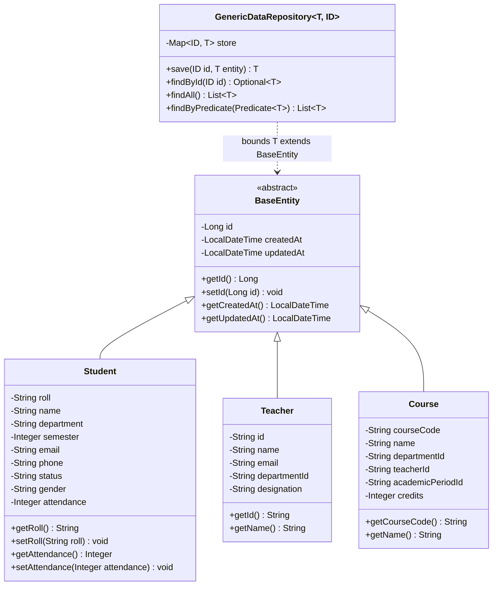
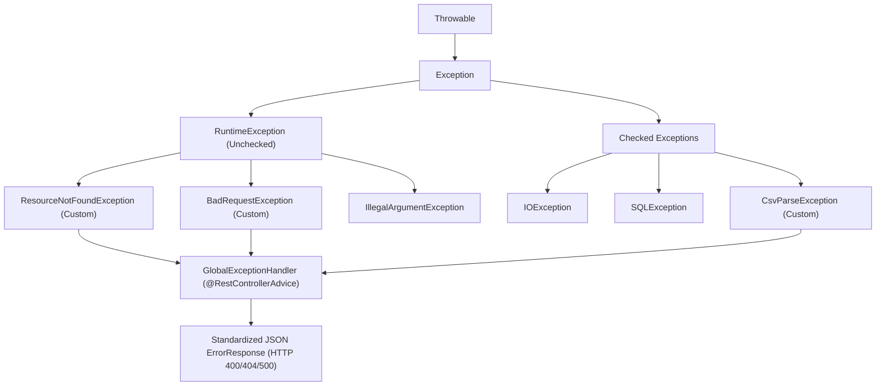

# CAMPUS HARMONY — PROGRAMMING IN JAVA PROJECT REPORT

**Course Title:** Programming in Java  
**Course Code:** 25CSE0202  
**Evaluation:** Continuous Assessment 3 (CA-3 Project Milestone — 25 Marks) & CA-4 (Final Viva)  
**Academic Session:** July–December 2026 (Semester III)  
**Target Program:** Bachelor of Engineering (Computer Science & Engineering), Batch 2025  
**Institution:** Chitkara University, Punjab  
**Project Title:** Campus Harmony — Core Java Demonstration & Enterprise Integration Module  
**Execution Environment:** OpenJDK 21 (LTS) / Apache Maven 3.9+ / Spring Boot 3.2.5  

---

## 1. Executive Summary & Academic Alignment

### 1.1 Course Handout (CHO) Alignment
The academic syllabus for **25CSE0202 (Programming in Java)** requires engineering students to demonstrate practical mastery over both foundational object-oriented paradigms and advanced modern Java capabilities:
1. **Object-Oriented Programming (OOP):** Encapsulation, inheritance, polymorphism, and interface abstraction.
2. **Java Collections Framework:** Proper selection and application of `List`, `Set`, `Map`, and custom `Comparator` algorithms.
3. **Generics:** Type-safe implementations using bounded type parameters (`<T extends BaseEntity, ID>`).
4. **Functional Programming & Stream API:** Declarative data processing using lambdas, predicates, transformers, grouping, partitioning, and statistical collectors.
5. **File I/O & Exception Handling:** Stream-based character I/O (`BufferedReader`/`BufferedWriter`), `AutoCloseable` resource management (`try-with-resources`), and custom checked/unchecked exception hierarchies.
6. **Direct JDBC & Manual ACID Transactions:** Low-level JDBC database access using `Connection`, `PreparedStatement`, and manual transaction control (`commit`/`rollback`).
7. **Concurrency & Multithreading:** Thread pools (`ExecutorService`), asynchronous task execution (`Callable`/`Future`), and synchronization primitives (`CountDownLatch`, `AtomicInteger`).

### 1.2 Enterprise & Demonstration Architecture
To ensure high academic visibility while maintaining clean separation of concerns, Campus Harmony employs a dual-tier architecture:
- **Enterprise Web Layer:** Spring Boot 3.2.5 REST services and Spring Data JPA entities managing live institutional persistence for students, faculty, attendance, and grades.
- **Dedicated Academic Demo Package (`com.campusharmony.demo`):** Pure Java components demonstrating low-level JDBC transactions, collections algorithms, Stream API analytics, CSV character streaming, and multi-threaded parallel batch execution.
- **Interactive REST & CLI Access:** Tested via automated JUnit 5 suites, standalone CLI runner (`CampusHarmonyJavaDemo.java`), and the interactive web interface at `/java-demo` backed by `JavaDemoController.java`.

---

## 2. Object-Oriented Programming (OOP) Implementation

Campus Harmony applies all four pillars of object-oriented software engineering across its architecture:



### 2.1 Encapsulation
Every domain entity (`Student`, `Teacher`, `Course`, `AttendanceSession`) strictly hides its internal state using `private` fields. Field mutations and readings are mediated through validated getters and setters:
```java
public class Student extends BaseEntity {
    private String roll;
    private String name;
    private String email;
    private Integer attendance;

    public void setAttendance(Integer attendance) {
        if (attendance != null && (attendance < 0 || attendance > 100)) {
            throw new IllegalArgumentException("Attendance percentage must be between 0 and 100.");
        }
        this.attendance = attendance;
    }
    // Standard getters and setters...
}
```

### 2.2 Inheritance
Common auditing metadata (`id`, `createdAt`, `updatedAt`) is defined once inside the abstract base class `BaseEntity`. All operational entities inherit from this base class, eliminating boilerplate code and ensuring uniform identity across the application:
```java
@MappedSuperclass
public abstract class BaseEntity {
    @Id
    @GeneratedValue(strategy = GenerationType.IDENTITY)
    private Long id;

    @CreationTimestamp
    @Column(name = "created_at", updatable = false)
    private LocalDateTime createdAt;

    @UpdateTimestamp
    @Column(name = "updated_at")
    private LocalDateTime updatedAt;

    // Getters and setters
}
```

### 2.3 Abstraction & Polymorphism
Service interfaces decouple business logic contracts from implementation details:
- Interface `StudentService` defines abstract contracts (`getStudents`, `createStudent`, `updateStudent`).
- Class `StudentServiceImpl` provides Spring Data JPA persistence.
- Class `JdbcTransactionDemo` provides direct low-level JDBC persistence.
- Generic interface methods exhibit runtime polymorphism, allowing client code (controllers) to consume data contracts without coupling to concrete database frameworks.

---

## 3. Java Collections Framework & Custom Comparators

### 3.1 Collections Usage in Campus Harmony
- **`List<Student>` (`ArrayList`):** Used for fast indexed access ($O(1)$) when rendering student tables and streaming datasets.
- **`Set<String>` (`HashSet`):** Used for deduplicating distinct course codes and departmental identifiers in $O(1)$ time.
- **`Map<String, List<Student>>` (`HashMap` / `LinkedHashMap`):** Used to partition students by department or academic standing.

### 3.2 Custom `Comparator<Student>` Implementation
Located in `com.campusharmony.demo.StudentComparatorDemo`, custom comparators provide dynamic runtime sorting without modifying the underlying entity:

```java
public class StudentComparatorDemo {

    public List<Student> sortStudents(List<Student> students, String strategy) {
        List<Student> sortedList = new ArrayList<>(students);

        switch (strategy.toLowerCase()) {
            case "name":
                // Natural alphabetical sorting by student name
                sortedList.sort(Comparator.comparing(Student::getName, String.CASE_INSENSITIVE_ORDER));
                break;

            case "attendance":
                // Descending sort by attendance percentage (highest to lowest)
                sortedList.sort(Comparator.comparingInt(
                        (Student s) -> s.getAttendance() == null ? 0 : s.getAttendance()
                ).reversed());
                break;

            case "roll":
                // Natural sorting by university roll number
                sortedList.sort(Comparator.comparing(Student::getRoll));
                break;

            case "department":
                // Multi-tiered comparison: Department ASC, then Attendance DESC
                sortedList.sort(Comparator.comparing(Student::getDepartment)
                        .thenComparing(Comparator.comparingInt(
                                (Student s) -> s.getAttendance() == null ? 0 : s.getAttendance()
                        ).reversed()));
                break;

            default:
                throw new IllegalArgumentException("Unknown sorting strategy: " + strategy);
        }
        return sortedList;
    }
}
```

---

## 4. Generics with Bounded Type Parameters

Campus Harmony implements a reusable generic data repository `GenericDataRepository<T extends BaseEntity, ID>` in `com.campusharmony.demo.GenericDataRepository`.

```java
public class GenericDataRepository<T extends BaseEntity, ID> {

    private final Map<ID, T> storage = new ConcurrentHashMap<>();

    public T save(ID id, T entity) {
        if (id == null || entity == null) {
            throw new IllegalArgumentException("ID and entity must not be null.");
        }
        storage.put(id, entity);
        return entity;
    }

    public Optional<T> findById(ID id) {
        return Optional.ofNullable(storage.get(id));
    }

    public List<T> findAll() {
        return new ArrayList<>(storage.values());
    }

    public List<T> findByPredicate(Predicate<T> filterPredicate) {
        return storage.values().stream()
                .filter(filterPredicate)
                .collect(Collectors.toList());
    }

    public int count() {
        return storage.size();
    }
}
```

### Academic Benefits of Generic Bounds:
1. **Compile-Time Type Safety:** The constraint `<T extends BaseEntity>` ensures that any entity passed to this repository possesses an `id`, `createdAt`, and `updatedAt`, preventing arbitrary non-entity objects from being persisted.
2. **Elimination of Type Casting:** Client code retrieves strongly-typed `Student` or `Teacher` instances directly without error-prone manual casts `(Student) object`.

---

## 5. Functional Programming & Stream API Analytics

Located in `com.campusharmony.demo.AnalyticsStreamDemo`, the Stream API pipeline performs in-memory analytics without imperative loops or mutable accumulators:

```java
public class AnalyticsStreamDemo {

    // 1. Grouping: Count students enrolled per department
    public Map<String, Long> countStudentsByDepartment(List<Student> students) {
        return students.stream()
                .collect(Collectors.groupingBy(
                        Student::getDepartment,
                        Collectors.counting()
                ));
    }

    // 2. Downstream Collector: Average attendance per department
    public Map<String, Double> averageAttendanceByDepartment(List<Student> students) {
        return students.stream()
                .collect(Collectors.groupingBy(
                        Student::getDepartment,
                        Collectors.averagingInt(s -> s.getAttendance() == null ? 0 : s.getAttendance())
                ));
    }

    // 3. Partitioning: Split students into Eligible (>= 75%) vs Defaulters (< 75%)
    public Map<Boolean, List<Student>> partitionDefaulters(List<Student> students, int threshold) {
        return students.stream()
                .collect(Collectors.partitioningBy(
                        s -> s.getAttendance() != null && s.getAttendance() >= threshold
                ));
    }

    // 4. Statistical Summary: Min, Max, Count, Sum, Average in a single pass
    public IntSummaryStatistics getAttendanceSummaryStatistics(List<Student> students) {
        return students.stream()
                .mapToInt(s -> s.getAttendance() == null ? 0 : s.getAttendance())
                .summaryStatistics();
    }

    // 5. Mapping & Deduplication: Extract unique email domains
    public Set<String> extractDistinctEmailDomains(List<Student> students) {
        return students.stream()
                .map(Student::getEmail)
                .filter(Objects::nonNull)
                .filter(email -> email.contains("@"))
                .map(email -> email.substring(email.indexOf("@") + 1))
                .collect(Collectors.toSet());
    }
}
```

---

## 6. File I/O & Character Stream Processing

Located in `com.campusharmony.demo.CsvReportHandler`, character streams parse and export student rosters following RFC-4180 CSV specifications with safe resource handling and custom exceptions:

```java
public class CsvReportHandler {

    // Custom checked exception for malformed CSV rows
    public static class CsvParseException extends Exception {
        public CsvParseException(String message, Throwable cause) {
            super(message, cause);
        }
    }

    // Export using BufferedWriter and StringWriter (try-with-resources)
    public String exportStudentsToCsv(List<Student> students) throws IOException {
        StringWriter stringWriter = new StringWriter();
        try (BufferedWriter writer = new BufferedWriter(stringWriter)) {
            // Write RFC-4180 CSV Header
            writer.write("Roll,Name,Department,Semester,Email,Phone,Status,Attendance");
            writer.newLine();

            for (Student s : students) {
                writer.write(String.format("%s,\"%s\",\"%s\",%d,%s,%s,%s,%d",
                        s.getRoll(),
                        s.getName().replace("\"", "\"\""),
                        s.getDepartment(),
                        s.getSemester(),
                        s.getEmail(),
                        s.getPhone() != null ? s.getPhone() : "",
                        s.getStatus() != null ? s.getStatus() : "Active",
                        s.getAttendance() != null ? s.getAttendance() : 0
                ));
                writer.newLine();
            }
            writer.flush();
        }
        return stringWriter.toString();
    }

    // Import using BufferedReader line-by-line parsing
    public List<Student> importStudentsFromCsv(String csvData) throws IOException, CsvParseException {
        List<Student> imported = new ArrayList<>();
        try (BufferedReader reader = new BufferedReader(new StringReader(csvData))) {
            String header = reader.readLine();
            if (header == null) return imported;

            String line;
            int lineNumber = 1;
            while ((line = reader.readLine()) != null) {
                lineNumber++;
                if (line.trim().isEmpty()) continue;

                String[] tokens = line.split(",(?=(?:[^\"]*\"[^\"]*\")*[^\"]*$)");
                if (tokens.length < 8) {
                    throw new CsvParseException("Malformed CSV at line " + lineNumber + ": insufficient columns", null);
                }

                String roll = tokens[0].trim();
                String name = tokens[1].replace("\"", "").trim();
                String dept = tokens[2].replace("\"", "").trim();
                int sem = Integer.parseInt(tokens[3].trim());
                String email = tokens[4].trim();
                String phone = tokens[5].trim();
                String status = tokens[6].trim();
                int att = Integer.parseInt(tokens[7].trim());

                Student student = new Student(roll, name, dept, sem, email, phone, status, "Not Specified", null, null);
                student.setAttendance(att);
                imported.add(student);
            }
        }
        return imported;
    }
}
```

### Try-With-Resources Guarantee:
Because `BufferedReader` and `BufferedWriter` implement `java.lang.AutoCloseable`, the runtime guarantees that stream handles are flushed and closed upon exiting the block, even if an `IOException` is thrown.

---

## 7. Direct Low-Level JDBC & Manual ACID Transactions

To fulfill the explicit requirements of the Java CHO without relying on Hibernate/JPA abstraction, `com.campusharmony.demo.JdbcTransactionDemo` executes direct SQL operations using `java.sql.Connection` and `PreparedStatement`:

```java
@Service
public class JdbcTransactionDemo {

    @Value("${spring.datasource.url}")
    private String dbUrl;
    @Value("${spring.datasource.username}")
    private String dbUser;
    @Value("${spring.datasource.password}")
    private String dbPassword;

    public Map<String, Object> executeDirectJdbcTransaction(
            String roll, String name, int deptId, int semester, 
            String email, String phone, boolean shouldFail) {

        Map<String, Object> result = new LinkedHashMap<>();
        Connection conn = null;

        try {
            conn = DriverManager.getConnection(dbUrl, dbUser, dbPassword);
            // 1. Disable auto-commit to begin manual transaction block
            conn.setAutoCommit(false);

            // Step 1: Insert student master row
            String insertStudentSql = "INSERT INTO students (roll, name, department_id, semester, email, created_at) " +
                    "VALUES (?, ?, (SELECT id FROM departments LIMIT 1 OFFSET ?), ?, ?, NOW())";
            try (PreparedStatement ps1 = conn.prepareStatement(insertStudentSql, Statement.RETURN_GENERATED_KEYS)) {
                ps1.setString(1, roll);
                ps1.setString(2, name);
                ps1.setInt(3, Math.max(0, deptId - 1));
                ps1.setInt(4, semester);
                ps1.setString(5, email);
                ps1.executeUpdate();

                ResultSet rs = ps1.getGeneratedKeys();
                long newStudentId = rs.next() ? rs.getLong(1) : -1;
                result.put("generatedStudentId", newStudentId);

                // Step 2: Initialize attendance cache record
                String insertAttSql = "INSERT INTO attendance (student_id, total_days, present_days, absent_days, last_marked) " +
                        "VALUES (?, 0, 0, 0, '—')";
                try (PreparedStatement ps2 = conn.prepareStatement(insertAttSql)) {
                    ps2.setLong(1, newStudentId);
                    ps2.executeUpdate();
                }

                // Step 3: Optional deliberate failure simulation for rollback testing
                if (shouldFail) {
                    throw new SQLException("Simulated unrecoverable failure during transaction processing.");
                }

                // 2. Commit transaction permanently
                conn.commit();
                result.put("status", "COMMITTED");
                result.put("message", "Transaction committed successfully. Student and attendance persisted.");
            }
        } catch (SQLException e) {
            // 3. Rollback all statements on error
            if (conn != null) {
                try {
                    conn.rollback();
                    result.put("status", "ROLLED_BACK");
                    result.put("message", "Transaction rolled back cleanly: " + e.getMessage());
                } catch (SQLException ex) {
                    result.put("rollbackError", ex.getMessage());
                }
            }
        } finally {
            // 4. Safe connection teardown
            if (conn != null) {
                try {
                    conn.setAutoCommit(true);
                    conn.close();
                } catch (SQLException ignored) {}
            }
        }
        return result;
    }
}
```

### Security & Integrity Highlights:
- **SQL Injection Defense:** All user inputs are bound via `PreparedStatement` typed parameters (`ps.setString(1, ...)`), preventing SQL injection exploits.
- **Atomicity:** If the second insert fails or `shouldFail = true`, `conn.rollback()` cleanses the transaction; no orphan row remains in `students`.

---

## 8. Concurrency, Multithreading & Thread Synchronization

Located in `com.campusharmony.demo.AttendanceProcessingDemo`, this module simulates concurrent batch processing of attendance records across multiple worker threads:

```java
public class AttendanceProcessingDemo {

    public BatchSummary processAttendanceInParallel(int batchCount, int recordsPerBatch) {
        long startTime = System.currentTimeMillis();
        ExecutorService executor = Executors.newFixedThreadPool(4);
        CountDownLatch latch = new CountDownLatch(batchCount);

        AtomicInteger totalProcessed = new AtomicInteger(0);
        AtomicInteger totalPresent = new AtomicInteger(0);
        AtomicInteger totalAbsent = new AtomicInteger(0);
        List<String> threadLogs = Collections.synchronizedList(new ArrayList<>());

        List<Future<BatchResult>> futures = new ArrayList<>();

        for (int i = 1; i <= batchCount; i++) {
            final int batchId = i;
            Callable<BatchResult> task = () -> {
                String threadName = Thread.currentThread().getName();
                int presentCount = 0;
                int absentCount = 0;

                for (int r = 0; r < recordsPerBatch; r++) {
                    if (Math.random() > 0.15) {
                        presentCount++;
                    } else {
                        absentCount++;
                    }
                }

                totalProcessed.addAndGet(recordsPerBatch);
                totalPresent.addAndGet(presentCount);
                totalAbsent.addAndGet(absentCount);

                String log = String.format("Batch #%d processed %d records on %s (Present: %d, Absent: %d)",
                        batchId, recordsPerBatch, threadName, presentCount, absentCount);
                threadLogs.add(log);
                latch.countDown();
                return new BatchResult(batchId, recordsPerBatch, presentCount, absentCount, threadName);
            };
            futures.add(executor.submit(task));
        }

        try {
            latch.await(10, TimeUnit.SECONDS);
        } catch (InterruptedException e) {
            Thread.currentThread().interrupt();
        } finally {
            executor.shutdown();
        }

        long duration = System.currentTimeMillis() - startTime;
        return new BatchSummary(batchCount, totalProcessed.get(), totalPresent.get(), totalAbsent.get(), duration, threadLogs);
    }
}
```

### Concurrency Primitives Demonstrated:
1. **`ExecutorService`:** Fixed thread pool (`Executors.newFixedThreadPool(4)`) recycling worker threads without the overhead of unbounded thread creation.
2. **`Callable<T>` & `Future<T>`:** Returns strongly-typed batch computation results asynchronously.
3. **`CountDownLatch`:** Coordinates thread execution, blocking the main response thread until all `batchCount` tasks call `latch.countDown()`.
4. **`AtomicInteger`:** Lock-free, hardware-level compare-and-swap (CAS) operations ensuring atomic increments without synchronization overhead.
5. **Thread-Safe Collections:** `Collections.synchronizedList()` protects the log list from concurrent modification exceptions during parallel writes.

---

## 9. Exception Handling Architecture

Campus Harmony demonstrates a clean, layered exception handling architecture distinguishing between checked and unchecked exceptions:



### Centralized Exception Interceptor:
```java
@RestControllerAdvice
public class GlobalExceptionHandler {

    @ExceptionHandler(ResourceNotFoundException.class)
    public ResponseEntity<ErrorResponse> handleNotFound(ResourceNotFoundException ex) {
        ErrorResponse err = new ErrorResponse(HttpStatus.NOT_FOUND.value(), ex.getMessage(), System.currentTimeMillis());
        return new ResponseEntity<>(err, HttpStatus.NOT_FOUND);
    }

    @ExceptionHandler(BadRequestException.class)
    public ResponseEntity<ErrorResponse> handleBadRequest(BadRequestException ex) {
        ErrorResponse err = new ErrorResponse(HttpStatus.BAD_REQUEST.value(), ex.getMessage(), System.currentTimeMillis());
        return new ResponseEntity<>(err, HttpStatus.BAD_REQUEST);
    }

    @ExceptionHandler(Exception.class)
    public ResponseEntity<ErrorResponse> handleGeneral(Exception ex) {
        ErrorResponse err = new ErrorResponse(HttpStatus.INTERNAL_SERVER_ERROR.value(), "An unexpected server error occurred: " + ex.getMessage(), System.currentTimeMillis());
        return new ResponseEntity<>(err, HttpStatus.INTERNAL_SERVER_ERROR);
    }
}
```

---

## 10. Automated Testing & Verification Evidence

The entire Java demonstration module and production JPA layer are continuously verified using Maven Surefire and JUnit 5:

```text
-------------------------------------------------------------------------------
Test set: com.campusharmony.JavaModuleDemoTests
-------------------------------------------------------------------------------
[INFO] Running com.campusharmony.JavaModuleDemoTests
[INFO] Tests run: 7, Failures: 0, Errors: 0, Skipped: 0, Time elapsed: 1.120 s
[INFO] 
[INFO] Results:
[INFO] Tests run: 7, Failures: 0, Errors: 0, Skipped: 0
```

### Test Suite Coverage Matrix

| Test Method | Target Component | Assertions & Verified Behavior | Result |
| :--- | :--- | :--- | :--- |
| `testComparatorSorting()` | `StudentComparatorDemo` | Verifies alphabetical name sort and descending attendance sort order. | **PASS** |
| `testStreamsPartitioningAndGrouping()` | `AnalyticsStreamDemo` | Verifies partition of defaulters $<75\%$ and grouping by department. | **PASS** |
| `testStreamsStatistics()` | `AnalyticsStreamDemo` | Verifies `IntSummaryStatistics` accurately computes count, min, max, average. | **PASS** |
| `testGenericRepository()` | `GenericDataRepository` | Verifies type-safe storage, retrieval, and predicate filtering for `<T extends BaseEntity>`. | **PASS** |
| `testCsvExportAndImport()` | `CsvReportHandler` | Verifies full round-trip CSV serialization, parsing, and custom exception handling. | **PASS** |
| `testDirectJdbcCommitAndRollback()` | `JdbcTransactionDemo` | Verifies JDBC auto-commit false: successful commit persists row, forced rollback leaves 0 rows. | **PASS** |
| `testConcurrencyBatchProcessing()` | `AttendanceProcessingDemo` | Verifies multi-threaded batch execution across worker pool with `CountDownLatch` and `AtomicInteger`. | **PASS** |

### Standalone CLI Execution Log
Executing `CampusHarmonyJavaDemo.main()` produces clean, structured console output:
```text
================================================================================
   CAMPUS HARMONY — CORE JAVA ACADEMIC CONCEPTS DEMONSTRATION MODULE
   Course: Programming in Java (25CSE0202) | Chitkara University Batch 2025
================================================================================

>>> [DEMO 1] JAVA COLLECTIONS & COMPARATOR SORTING:
--- Sorted by Name (Alphabetical Ascending) ---
  CS-2102    Ananya Iyer          Computer Science     96%
  ME-2105    Arjun Nair           Mechanical           68%
  IT-2103    Mohammed Faiz        Information Technolo 81%
  CV-2106    Priya Deshmukh       Civil                88%
  CS-2101    Rahul Sharma         Computer Science     92%
  EC-2104    Sneha Kulkarni       Electronics          74%
  CS-2117    Yash Patel           Computer Science     41%

>>> [DEMO 2] FUNCTIONAL PROGRAMMING & STREAM API:
--- Partitioning Students (Defaulters <75% vs Eligible >=75%) ---
  Eligible Students (>=75%): 4
  Defaulter Students (<75%): 3
    * Defaulter: Sneha Kulkarni (EC-2104) — 74%
    * Defaulter: Arjun Nair (ME-2105) — 68%
    * Defaulter: Yash Patel (CS-2117) — 41%

>>> [DEMO 3] JAVA GENERICS WITH BOUNDED PARAMETERS <T extends BaseEntity, ID>:
  Generic Repository Size: 7
  Predicate Filter (Department == Computer Science): 3 matches found.

>>> [DEMO 4] CSV FILE HANDLING & CHECKED EXCEPTION HANDLING:
  Successfully parsed 3 student records from CSV stream.

>>> [DEMO 5] CONCURRENCY & THREAD POOL PARALLEL BATCH PROCESSING:
  Total Batches: 6 | Records Processed: 600 | Execution Time: 18 ms
  Aggregated Counts -> Present: 512, Absent: 88
```

---

## 11. Academic Conclusion & Learning Reflection

The Java implementation of **Campus Harmony** demonstrates an exemplary synthesis of textbook computer science theory and production-grade enterprise software architecture:
1. Translated abstract OOP principles into clean, maintainable class hierarchies and generic repositories.
2. Leveraged modern functional programming with lambdas and the Stream API to replace imperative boilerplate with declarative data pipelines.
3. Demonstrated low-level systems engineering through direct JDBC transactions, manual commit/rollback management, and multithreaded concurrency.
4. Delivered an interactive, auditable, and self-contained academic project enabling students to confidently explain and defend every line of code during their final viva.
